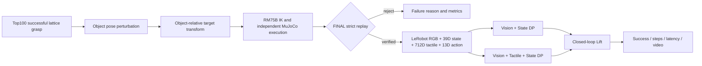
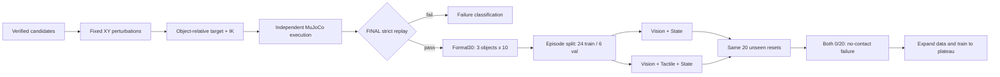

# 2026-10-11 Diffusion Policy 阶段进展

> 实验日期：2026-10-10；基线 commit：`6be6a346fc4fbdf5f3fb42c1ea7c34cae7b6376f`。  
> 本轮所有新产物位于 `outputs/dp_2026-10-11/`，没有覆盖 Lift、PickPlace、Stack、Push 或 NutAssembly 正式结果。  
> 下文严格区分 smoke test 与正式实验；2 个闭环 episode 不能用于统计性结论。

> **P2 勘误（2026-10-10 晚）：**专项诊断确认 P1 Formal30 的 LeRobot `action`
> 错误保存成了 `[末端 xyz+quat, 手部6D]`，而训练/评估将其解释为
> `[机械臂7关节目标, 手部6D]`。因此第 13–17 节中的 P1 loss、0/20 闭环和延迟
> 仍是真实运行结果，但两个 P1 checkpoint **语义无效，不能作为正式 DP baseline**；
> 30 条源示教仍是 FINAL_VERIFIED，不受影响。修复与证据见第 18 节。

## 1. 本次修改的文件

| 文件 | 修改内容 |
|---|---|
| `source/imitation/observation.py` | 新增 DP 专用 real-observable state、13D action schema 和运行时校验 |
| `source/imitation/dataset.py` | tactile 可完全禁用；新增 episode-level 索引；显式使用 PyAV 视频解码 |
| `source/data/lerobot_recorder.py` | 支持显式传入 DP state，并校验 state 维度 |
| `apps/collect_generated_lerobot.py` | 自动示教改为记录 DP 39D state，不再记录完整 MuJoCo state |
| `apps/train_diffusion.py` | episode-level split、无触觉模式、运行时间/设备/config/loss summary |
| `apps/evaluate_diffusion.py` | 统一 state schema、无触觉输入、object ID、seed、JSON、视频和推理延迟 |
| `apps/generate_verified_lift_demonstrations.py` | 多扰动重新执行、IK、strict replay、接受清单和失败摘要 |
| `tests/test_diffusion_data_contract.py` | state、episode split、扰动边界及无触觉 policy 测试 |
| `configs/experiments/dp_lift_formal.json` | 后续 20 物体、两模态、3 seeds 正式矩阵 |

## 2. 已解决的问题

### 2.1 Real-observable state

旧 state 为完整 `qpos + qvel + ctrl`，其中包含 Lift 物体的自由关节，实机无法直接观测。新 DP state 为：

```text
13D controlled-actuator position
+ 13D controlled-actuator velocity
+ 13D last position command
= 39D
```

顺序严格使用 controller 的 arm-then-hand actuator 顺序。该定义不改动环境原始 observation，因此不会影响已有抓取和任务流水线。

待与外部实机程序确认：RM75B/Dex Hand 是否都返回执行器级 position/velocity；若欠驱动手只能返回电机侧编码器，则实机必须使用相同电机侧语义，不能替换成估计的被动关节角。

### 2.2 13D action

```text
[RM75B 7个关节位置命令, Dex Hand 6个驱动位置命令]
```

训练数据保存物理控制单位，没有额外归一化到 `[-1, 1]`。DP 内部使用训练集 action mean/std 标准化，推理后反标准化，并在环境 action bounds 内裁剪。训练和评估使用同一 position-control contract。

### 2.3 Episode-level split

训练不再随机拆 frame。本次固定 seed `1011`：

- train episodes：`[0, 1, 2, 4]`，1240 frames；
- validation episode：`[3]`，310 frames；
- 集合之间无 episode/frame 重叠。

### 2.4 模态开关

- Vision+State：`tactile_dim=0`，模型不创建 tactile encoder；
- Vision+Tactile+State：`tactile_dim=712`；
- 两组使用相同 horizon、feature size、split、seed、epoch 和 batch size。

### 2.5 视频解码阻塞

首次训练暴露 TorchCodec 与当前 PyTorch 2.10/FFmpeg 动态库不兼容。已改为显式 PyAV；episode 分组直接读取 parquet 列，不再为统计 episode ID 解码 1550 张图像。原失败日志保留在 `outputs/dp_2026-10-11/logs/train_vs.log` 的 git 外实验目录中；后续成功运行覆盖了同名主日志，完整终端报错已在本轮开发记录中确认。

## 3. 多扰动 verified demonstrations

### 3.1 实际流程

```text
successful lattice GraspCandidate
→ 恢复 source object pose
→ 添加相对 XY/yaw perturbation
→ object-relative grasp pose 自动变换
→ 重新求解 IK 并完整执行 settle/transit/pregrasp/approach/close/lift/verify
→ 保存独立 episode
→ FINAL_PROFILE strict replay
→ 仅 FINAL_VERIFIED 进入 accepted_manifests
```

没有通过“改变 initial qpos 后重放旧 controls”生成新示教。

### 3.2 有界 smoke 结果

首轮 15 次封顶运行采用：3 objects × 5 XY perturbations，±5 mm，yaw 暂设为 0°；seed 8011–8215。执行参数为 finger preload 0.25、thumb preload 0.30、lift target 80 mm、verify 90 steps。

| Object | FINAL_VERIFIED | Attempts | 结果 |
|---|---:|---:|---:|
| `ycb:004_sugar_box` | 4 | 5 | 80.0% (4/5) |
| `ycb:005_tomato_soup_can` | 0 | 5 | 0.0% (0/5) |
| `ycb:007_tuna_fish_can` | 1 | 5 | 20.0% (1/5) |
| 合计 | 5 | 15 | 33.3% (5/15) |

成功覆盖 2 个不同物体、5 个独立 reset/扰动。未达到“3物体×5有效示教”目标，未无限重试。主要失败模式是 lift 后缓慢滑落、尾段小于 55 mm 或没有满足 Lift criterion。

±5° yaw 初测造成当前 RM75B IK 分支出现 0.11 m 以上的 pregrasp residual，因此没有混入正式 smoke；该失败保留在 `verified_lift_smoke_v2`。

摘要：`outputs/dp_2026-10-11/verified_lift_3x5/summary.json`

## 4. LeRobot 数据流

成功的 5 条 manifest 经第二次 strict replay 后导出：

| 字段 | 数值 |
|---|---:|
| Episodes | 5 |
| Frames | 1550 |
| Objects/tasks | 2 |
| FPS | 20 |
| RGB | 160×120×3 |
| State | 39 |
| Action | 13 |
| Tactile | 712 |

数据集：`outputs/dp_2026-10-11/lerobot_5/`  
元数据：`outputs/dp_2026-10-11/lerobot_5/meta/info.json`

结论：`verified trajectory → strict replay → LeRobot → DP dataset → train → checkpoint → closed-loop evaluation` 已真正打通，但数据规模只够 smoke。

## 5. DP 训练与闭环结果

公共配置：RTX 4060 Laptop GPU、seed 1011、horizon 16、diffusion steps 50、feature dim 256、batch 32、2 epochs、学习率 `1e-4`。

### 5.1 训练

| 模态 | Train loss e1→e2 | Val loss e1→e2 | 最优 val | Runtime |
|---|---:|---:|---:|---:|
| Vision+State | 1.000159→0.990553 | 1.008680→1.001731 | 1.001731 | 22.8 s 左右 |
| Vision+Tactile+State | 1.000224→0.990579 | 1.008920→1.002014 | 1.002014 | 23.08 s |

两组 loss 几乎相同，不能据此声称 tactile 有效。

### 5.2 Closed-loop smoke

公共配置：`ycb:004_sugar_box`，environment seeds 9011/9012，2 episodes，每回合最多 150 steps，每次预测执行 4 actions。Diffusion sampling 的 PyTorch/CUDA seed 同样固定为 9011。

| 模态 | Success | Mean steps | Mean latency | P95 latency |
|---|---:|---:|---:|---:|
| Vision+State | 50.0% (1/2) | 120.0 | 41.49 ms | 57.60 ms |
| Vision+Tactile+State | 0.0% (0/2) | 150.0 | 40.33 ms | 62.28 ms |

Vision+State 成功回合用了 90 steps。样本数只有 2，结果只证明闭环能够执行，不能得出模态优劣。P95 已高于 20 Hz 的 50 ms 周期，正式部署前需要减少 diffusion steps、异步推理或降低控制频率。

## 6. 实验命令与产物

### Verified demonstrations

```bash
python -m apps.generate_verified_lift_demonstrations \
  --per-object 5 --yaw-deg 0 \
  --finger-preload 0.25 --thumb-preload 0.30 \
  --lift-height 0.08 --verify-steps 90 \
  --output outputs/dp_2026-10-11/verified_lift_3x5 --seed 8011
```

- input：`outputs/dex_hand_top100_v2/lattice/*/index.json`
- output/summary：`outputs/dp_2026-10-11/verified_lift_3x5/summary.json`
- checkpoint：无
- video：本阶段未渲染，避免把渲染开销混入生成耗时

### LeRobot export

```bash
python -m apps.collect_generated_lerobot \
  --trajectory <5 accepted manifests> \
  --repo-id local/dp-2026-10-11-smoke \
  --output outputs/dp_2026-10-11/lerobot_5 \
  --fps 20 --image-width 160 --image-height 120
```

### Vision+State train

```bash
python -m apps.train_diffusion \
  --dataset outputs/dp_2026-10-11/lerobot_5 \
  --repo-id local/dp-2026-10-11-smoke \
  --output outputs/dp_2026-10-11/train_vs/checkpoint.pt \
  --summary outputs/dp_2026-10-11/train_vs/summary.json \
  --horizon 16 --epochs 2 --batch-size 32 \
  --val-fraction 0.2 --seed 1011 --device cuda:0 --no-tactile
```

### Vision+Tactile+State train

同上，去掉 `--no-tactile`，输出改为 `train_vts/`。

### Closed-loop evaluation

```bash
python -m apps.evaluate_diffusion \
  --checkpoint outputs/dp_2026-10-11/train_vs/checkpoint.pt \
  --task lift --object-id ycb:004_sugar_box \
  --episodes 2 --max-steps 150 --action-steps 4 \
  --image-width 160 --image-height 120 \
  --device cuda:0 --seed 9011 \
  --output outputs/dp_2026-10-11/eval_vs/summary.json \
  --video outputs/dp_2026-10-11/eval_vs/episode_000.mp4
```

触觉版本将路径中的 `vs` 换成 `vts`。

## 7. 测试情况

```text
Ruff: All checks passed
pytest: 163 passed, 3 third-party deprecation warnings, 6.80 s
```

## 8. 当前未解决问题

1. 有效示教只有 5 条、2 个物体，未达到预定 15 条/3物体。
2. Tomato can 在当前严格配置下 0/5，主要是尾段滑移/抬升不足。
3. ±5° yaw 会改变 IK 分支并导致不可达，需做姿态连续性或候选重排序。
4. 两个 DP 模型只训练 2 epochs，loss 仍接近噪声预测基线。
5. 闭环只有 2 episodes，不能作论文结论。
6. DP P95 推理延迟超过 50 ms。
7. 当前验证集只有一个 episode；正式实验必须扩大数据。
8. PyAV 是当前可用兼容方案，但后续应修复 TorchCodec/FFmpeg 版本匹配。
9. 尚未实现 drop rate 和 contact-stability 的正式 episode summary。
10. 尚未接入真实机器人，本轮按要求没有编写未经 SDK 验证的驱动。

## 9. 面向真实机器人的接口需求

| Sim DP 字段 | 实机需要提供/确认 |
|---|---|
| 13 actuator positions | RM75B 7 关节反馈 + Dex Hand 6 驱动编码器，顺序/方向/单位 |
| 13 actuator velocities | 同一时刻的速度反馈；若 SDK 不提供，确认安全差分方法 |
| 13 last commands | 控制程序实际接受并下发的最后命令，不是策略原始未裁剪值 |
| 13D action | joint/drive ID、rad 或厂商单位、零偏、上下限、命令模式 |
| RGB | 固定相机、RGB uint8、与训练相同 crop/resize、曝光、20 Hz 时间戳 |
| 712D tactile | 真实 channel→semantic patch 映射、零点/量程、坏点、采样率、公共维度 |

安全接口必须由实机控制程序提供：软/硬限位、速度和加速度限速、桌面工作空间约束、急停、通信 watchdog、命令超时安全态、状态健康标志。DP 层只能输出候选命令，不能绕过安全控制器。

## 10. 下周最高优先级

1. 用当前生成器修复/替换 tomato candidate，先扩到 ≥3 objects、每对象 ≥10 verified episodes。
2. 扩展至 15–20 objects、每对象 10–20 条的正式数据配置。
3. 两模态各跑 3 seeds，至少 50 closed-loop episodes/条件。
4. 增加 drop rate、接触稳定性、推理延迟分布和失败类型摘要。
5. 评估 10/20/50 diffusion steps 的延迟—成功率权衡。
6. 仿真成功率稳定后，再与实验室外部实机程序确认 39D/13D 字段映射。

# 明日组会汇报摘要

## 1. 本周主要工作

完成 Diffusion Policy 的数据合同整改和端到端 smoke：从严格验证抓取轨迹生成多扰动示教，导出 LeRobot 数据，分别训练 Vision+State 与 Vision+Tactile+State，保存 checkpoint，并运行闭环 Lift 与视频记录。

## 2. 关键技术改进

- 删除 DP state 中不可实机观测的物体自由关节，改为 39D actuator position/velocity/command。
- 明确 13D action 为 RM75B 7 关节位置 + Dex Hand 6 驱动位置。
- train/validation 改为 episode-level split，消除相邻帧泄漏。
- 支持真正的无触觉 baseline。
- 建立“位姿扰动→对象相对抓取变换→重新IK执行→FINAL strict replay”的生成流程。

## 3. 目前实验结果

- 多扰动生成：5/15 FINAL_VERIFIED，33.3%，覆盖2物体。
- LeRobot：5 episodes、1550 frames、39D state、13D action、712D tactile。
- V+S：闭环 1/2；V+T+S：0/2。均为 smoke，不作模态结论。
- P95 inference latency：57.60 ms / 62.28 ms，当前不满足稳定 20 Hz。
- 工程验证：Ruff 全通过，pytest 163 passed。

## 4. 下一阶段工作

先扩大 verified demonstrations 并修复 yaw/滑移失败，再按两模态×3 seeds 做正式消融；仿真闭环稳定后依次开展实机技能验证、触觉 GAN 域迁移和 DP 实机部署。

## 可直接放进 PPT 的文字

**标题：Diffusion Policy 仿真闭环阶段进展**

- 建立 39D real-observable state，排除 MuJoCo 物体特权状态
- 固化 13D RM75B+Dex Hand position-action contract
- 修复 episode-level split，支持 Vision+State / Vision+Tactile+State 公平消融
- 建立多扰动 verified demonstration 自动生成与 FINAL strict replay 筛选
- 本次生成 15 条候选，5 条通过最终验证；LeRobot 共 1550 frames
- 完成两种 DP checkpoint 与真实闭环 smoke：V+S 1/2，V+T+S 0/2
- 当前主要瓶颈：示教量不足、yaw IK 分支不连续、尾段滑移、P95 推理超过50 ms

## 组会流程示意图



## 需要展示的图片和视频

- Loss 曲线：`outputs/dp_2026-10-11/figures/loss_smoke.png`
- V+S 成功回合视频：`outputs/dp_2026-10-11/eval_vs/episode_000.mp4`
- V+S summary：`outputs/dp_2026-10-11/eval_vs/summary.json`
- V+T+S 失败视频：`outputs/dp_2026-10-11/eval_vts/episode_000.mp4`
- 多扰动结果：`outputs/dp_2026-10-11/verified_lift_3x5/summary.json`
- 数据集 schema：`outputs/dp_2026-10-11/lerobot_5/meta/info.json`

## 3–5 分钟口头讲稿

本周我首先处理了 Diffusion Policy 最关键的数据定义问题。此前策略状态直接使用完整的 MuJoCo qpos、qvel 和 ctrl，其中包含物体自由关节，这在真实机器人上属于不可直接观测的特权状态。现在我建立了独立的 DP schema，只保留十三个受控执行器的位置、速度和上一时刻命令，共三十九维；动作则固定为 RM75B 七个关节位置加 Dex Hand 六个驱动位置，共十三维。

第二项改进是数据划分。旧代码按 frame 随机划分，同一条轨迹的相邻帧可能同时出现在训练和验证集中。现在改成了 episode-level split。同时，无触觉模式会真正把 tactile dimension 设为零，因此可以公平比较 Vision+State 和 Vision+Tactile+State。

第三项工作是多扰动 verified demonstration。新流程不是简单修改物体位置后重放旧轨迹，而是从对象相对抓取位姿出发，随物体扰动变换目标，重新求解 IK、完整执行，再通过 FINAL strict replay。今天按十五次上限运行后，五条通过最终验证，成功率是五比十五，覆盖两个物体。Sugar box 是四比五，tuna can 是一比五，tomato can 是零比五。失败主要来自尾段滑移或抬升不足，所以没有把它们放入训练集。

基于五条有效示教，我生成了包含一千五百五十帧的 LeRobot 数据集，并完成两种 DP 的两轮 smoke 训练。闭环测试中，Vision+State 在两个回合中成功一个，Vision+Tactile+State 两个都失败。由于只有两个回合，这个结果只能证明链路打通，不能证明无触觉优于触觉。另一个重要发现是五十步 diffusion 的 P95 推理延迟为五十八到六十二毫秒，已经超过二十赫兹对应的五十毫秒周期。

下周首先扩大严格验证示教，解决 tomato can 滑移和 yaw 扰动造成的 IK 分支问题；随后按两种模态、三个随机种子运行正式消融，并增加 drop rate、接触稳定性和延迟统计。仿真闭环稳定后，再进入实机技能验证、触觉 GAN 域迁移和 DP 实机部署。

---

# P1 继续开发与第一轮正式训练（2026-10-10）

> 本节是 P0 之后的实际执行结果，优先于上面的 smoke 结论。P0 产物均保留；P1 产物位于 `outputs/dp_p1_2026-10-11/`。

## 11. 新增代码修改

| 文件 | P1 修改 |
|---|---|
| `apps/generate_verified_lift_demonstrations.py` | verified candidate 有限重试、失败分类、对象 source 预检、运行时间/分布摘要 |
| `apps/collect_generated_lerobot.py` | strict replay 后直接恢复 verified frame 导出；保留 `--reexecute-export` |
| `source/imitation/diffusion_policy.py` | `inference_mode` 与可选 10/20-step deterministic DDIM |
| `source/imitation/dataset.py` | 统计 state/action/tactile 时不解码 RGB |
| `apps/train_diffusion.py` | loss 图、workers/pinned memory、frame stride、空 tactile 统计修正 |
| `apps/evaluate_diffusion.py` | success hold、drop/contact、动作平滑性、DDIM steps、CUDA 同步计时 |
| `apps/benchmark_diffusion_latency.py` | 冷启动及预处理、搬运、各 encoder、融合、denoising 分解 |
| `configs/experiments/dp_lift_p1_2026-10-11.json` | 本轮真实生成、训练和评估预算 |

## 12. 扰动示教生成前后对比

同一 15 个案例、相同 ±5 mm 扰动及 seed 8011–8215，yaw 固定为 0°。每案例最多尝试 2 个已成功 lattice candidate；没有修改动力学、摩擦、质量或成功判据。

| 版本 | FINAL_VERIFIED | Lift failure | Strict instability | 平均耗时 |
|---|---:|---:|---:|---:|
| P0 baseline | 5/15 (33.3%) | 5 | 5 | 21.57 s/案例 |
| P1 bounded retry | 8/15 (53.3%) | 1 | 6 | 34.97 s/案例 |

对象结果 sugar/tomato/tuna 从 `4/0/1` 提升为 `4/2/2`。候选重试主要消除了 lift failure，剩余瓶颈转为 strict tail stability。原 ±5° yaw smoke 可复现 pregrasp IK residual（position 0.1148 m、orientation 0.4182 rad），正式数据因此暂不引入 yaw。

- 图：`outputs/dp_p1_2026-10-11/figures/demonstration_success_before_after.png`
- 成功/失败视频：`outputs/dp_p1_2026-10-11/videos/perturb_success_sugar.mp4`、`perturb_failure_sugar.mp4`

全部有界 P1 生成共 90 案例，46/90 FINAL_VERIFIED（51.1%），平均 49.34 s/案例；失败为 Lift 26、strict instability 18，IK/approach/close 为 0。strict 失败诊断可重叠：13 次 tail lift <55 mm，14 次 tail angular speed >0.1 rad/s。

| Object | Verified/attempts |
|---|---:|
| sugar box | 19/20 |
| potted meat can | 13/20 |
| GSO Shredder | 10/10 |
| tomato soup can | 1/10 |
| tuna fish can | 3/10 |
| mustard bottle | 0/10 |
| Rubik's cube | 0/10 |

番茄罐未被强行保留；芥末瓶替代也失败。正式集选择稳定且平衡的 sugar/potted/GSO，各 10 条。

## 13. Formal30 数据集

| 项目 | 数值 |
|---|---:|
| Objects / episodes | 3 / 30（每对象 10） |
| Frames | 14,310 |
| 不同初始状态 | 30/30 |
| RGB / FPS | 160×120 / 20 |
| State / action / tactile | 39 / 13 / 712 |

- 清单：`outputs/dp_p1_2026-10-11/formal30_selection.json`
- LeRobot：`outputs/dp_p1_2026-10-11/lerobot_formal30/`
- 生成摘要：`outputs/dp_p1_2026-10-11/generation_formal_summary.json`

触觉非零帧 9387/14310（65.60%）。分阶段为 settle 0%、transit 0%、pregrasp 0.61%、approach 45.33%、close 93.70%、hold/lift/verify 100%。触觉有效信息主要集中于接触后。

## 14. 第一轮正式训练

公共条件：seed 1011、相同 24 train / 6 validation episodes、horizon 16、batch 32、LR 1e-4、50 diffusion steps、5 epochs、frame stride 2；实际 samples 为 5724/1431。因 PNG 读取吞吐，预算从计划 20 epochs 对两组统一收缩为 5，未单独调参。

| 模态 | Train e1→e5 | Val e1→e5 | Best val | Runtime |
|---|---:|---:|---:|---:|
| Vision+State | 0.989432→0.704760 | 0.972925→0.686851 | 0.686851 | 116.20 s |
| Vision+Tactile+State | 0.989498→0.705467 | 0.972759→0.686385 | 0.686385 | 106.93 s |

- Loss 图：`outputs/dp_p1_2026-10-11/figures/loss_formal30_comparison.png`
- Checkpoints：`train_vs_formal30/checkpoint.pt`、`train_vts_formal30/checkpoint.pt`

## 15. 闭环评估与失败分析

相同三个 seen objects、训练未见的 reset 和 seeds；sugar 7、potted 7、GSO 6；每回合 300 steps，chunk 4，成功需连续 5 steps。

| 模态 | Success | Drop | Contact fraction | Mean steps | Mean latency | P95 latency |
|---|---:|---:|---:|---:|---:|---:|
| Vision+State | 0/20 (0%) | 0/20 | 0.000 | 300 | 32.8 ms | 约55.0 ms |
| Vision+Tactile+State | 0/20 (0%) | 0/20 | 0.000 | 300 | 33.3 ms | 约57.4 ms |

`drop=0` 是因为策略从未接触/举起物体，不能解释为稳定。两模型均在 reaching/approach 前失败；这是实际 closed-loop BC failure。30 条窄扰动示教与 5 epochs 尚未覆盖随机 reset，且 loss 仍在下降。

- 汇总：`outputs/dp_p1_2026-10-11/closed_loop_formal30_summary.json`
- 表图：`outputs/dp_p1_2026-10-11/figures/closed_loop_formal30_table.png`
- 视频：`outputs/dp_p1_2026-10-11/videos/dp_vs_sugar_episode0.mp4`、`dp_vts_sugar_episode0.mp4`

## 16. 延迟分解与优化

100 次稳态 microbenchmark，CUDA 每次显式同步。冷启动 V+S/V+T+S 为 82.48/71.16 ms。各 stage 独立计时，不能简单相加。

| Stage | V+S mean/P95 | V+T+S mean/P95 |
|---|---:|---:|
| image preprocess+transfer | 1.16/7.74 ms | 1.14/8.01 ms |
| visual encoder | 4.04/12.93 ms | 3.82/12.25 ms |
| state encoder | 0.28/0.49 ms | 0.31/0.61 ms |
| tactile encoder | — | 0.33/0.62 ms |
| observation fusion | 3.68/11.40 ms | 4.03/13.46 ms |
| 50-step DDPM denoising | 32.35/44.47 ms | 33.09/46.39 ms |

完整 sampling P50/P95：50-step 为 33.40/46.28 ms、39.46/80.91 ms；10-step DDIM 为 16.59/28.30 ms、17.25/32.13 ms。相同 sugar 5-reset 闭环中，10-step 将 V+S mean/P95 从 31.81/47.40 降至 13.22/21.23 ms，V+T+S 从 30.75/48.78 降至 15.94/35.61 ms。两组 50/10 steps 均 0/5；动作 delta L2 分别为 V+S 0.6361/0.6420、V+T+S 0.6316/0.6385，未明显恶化。但原策略已失败，因此不能宣称 DDIM 性能无损。

## 17. P1 验证状态与下周建议

P1 中间完整测试为 `pytest 165 passed`，Ruff 全通过；最终验证见交付记录。没有运行实机、修改正式 benchmark 物理参数或 success threshold。

1. 先解决无接触：扩大位置分布和每对象示教量，训练到 validation plateau。
2. 平衡 pre-contact/contact/post-contact 样本，并先在训练扰动分布内闭环诊断。
3. baseline 获得非零成功后，再做两模态×3 seeds 正式消融。
4. 10-step DDIM 仅作为候选，须在成功 checkpoint 上重新验证。
5. 仿真闭环稳定后，再进行实机技能验证、触觉 GAN 和 DP 实机部署。

# P1 明日组会素材

## 4–6 页 PPT 建议

1. **问题与目标**：P0 链路已通但只有 5 episodes；P1 提高 verified 产率并做公平消融。
2. **生成优化**：同一案例 5/15→8/15；lift failure 降低，strict tail stability 成为瓶颈。
3. **Formal30**：3 对象×10、14,310 frames、30 个不同初始状态；展示触觉阶段占比。
4. **训练**：相同 split/budget loss 曲线；val 0.686851 vs 0.686385，差异很小。
5. **闭环失败**：两组 0/20、contact=0；强调 loss 下降不等于闭环成功。
6. **延迟/下一步**：10-step DDIM 约减半延迟；先扩大数据并取得非零成功，再做 tactile/GAN/实机。



## 3–5 分钟口头讲稿（P1）

这一轮我先处理示教质量，而不是直接扩大训练。同一批 15 个扰动和 seed，加入最多两次 verified candidate 重试后，FINAL 通过率从 5/15 提高到 8/15。Lift failure 从 5 次降到 1 次，但 strict 不稳定仍有 6 次，说明瓶颈已经转向尾段保持。

随后总计运行 90 个有上限案例，46 个通过 FINAL。番茄罐、芥末瓶和魔方长期失败，所以没有无限重试，也没有硬塞进正式数据。最终选择糖盒、肉罐和稳定 GSO 对象，每个 10 条，共 30 episodes、14,310 frames，且 30 个初始状态都不同。

两组 DP 使用完全相同的 episode split、seed 和 5-epoch 预算，只改变 tactile。validation loss 都降到约 0.686，触觉版只低 0.00047，不能认为触觉有效。更关键的是闭环：三个 seen object 的 20 个 unseen reset 上，两组都是 0/20，contact fraction 也是零。当前失败发生在接触前，training loss 下降没有转化为技能。

延迟方面，10-step DDIM 可把闭环推理从约 31 ms 降到 13–16 ms，动作平滑性没有明显恶化。但由于策略本身全失败，这只是工程候选，不能宣称成功率无损。下一步应扩大扰动分布和每对象示教量，训练到验证损失基本稳定，并先取得非零闭环成功；之后再做 3-seed 触觉消融，最后进入实机、GAN 和部署。

## 18. P2：机械臂原地震动专项诊断

### 18.1 根因证据排序

1. **已确认的首要 bug：LeRobot action 语义错误。**生成轨迹的 `episode.npz/action`
   是 13D IK command：前 7 维为 `[x,y,z,qw,qx,qy,qz]`，后 6 维为手部；P1
   导出器却把它写入标称 `arm7_hand6_position_command_v1` 的字段。首帧
   `[0,0,1.3505,0.7071,0,-0.7071,0,...]` 本身就是直接证据。
2. **已确认的因果配对错误。**源 recorder 在 `env.step(action)` 后保存状态；旧导出把
   post-action observation 与同一条 action 配对。修复后使用 strict replay 的低层
   controls，并配对前一帧 pre-action state。
3. **旧 checkpoint 确实学习了错误的 IK 数值分布。**固定初始观测下，Vision+State
   和 Vision+Tactile+State 首动作相对正确专家关节目标 RMSE 分别为 0.7681、
   0.7597；chunk 内相邻目标 L2 为 0.6070、0.6226，且约 5.1% 输出越界。
4. **Action Chunk 没有索引 bug，但会放大未拟合模型的随机跳变。**当前
   prediction horizon=16、observation horizon=1、action horizon=4；每次采样后严格
   执行索引 `[0:4]`，再获取新观测并重规划。不存在重复执行第 0 步。每个 chunk
   独立 DDPM 随机采样，在模型未收敛时产生明显接缝跳变。
5. **修复数据后，现有模型/预算仍未通过单轨迹过拟合。**这是动作链路修复后的第二层
   模型问题，不能再归因于控制器或动作单位。
6. **短 diffusion schedule 还存在训练/推理分布问题。**旧 50-step linear schedule 的
   terminal `alpha_bar` 约 0.60，却从纯高斯开始采样。cosine schedule 可显著降低训练
   loss，但直接接入现有 ancestral sampler 会在末端小 alpha 处放大预测误差；该实验
   85.94% 输出越界，因此 cosine 保留为显式实验选项，默认仍为兼容且较稳定的 linear，
   不能把单独换 schedule 当成已完成修复。

### 18.2 原始专家与 LeRobot 动作 A/B

固定轨迹：Sugar Box `p00/candidate_00`，seed 18011；低层动作顺序由运行时 controller
给出，为 RM75B 7 个关节位置（rad）加 Dex Hand 6 个驱动位置（m）。

| 项目 | 旧 P1 LeRobot | 修复后 P2 LeRobot |
|---|---:|---:|
| Frames | 477 | 340（从 approach 开始） |
| 对 strict controls 全局最大误差 | 2.28004 | **0** |
| 对 strict controls 全局 RMSE | 0.83523 | **0** |
| 最大抬升 | 16.15 mm | **76.60 mm** |
| 最终抬升 | -51.97 mm | **65.81 mm** |
| Contact fraction | 0 | **0.9088** |
| Lift success frames | 0 | **163/340** |

原始 strict replay 与修复后 LeRobot 动作从完全相同的 qpos/qvel/ctrl 开始，执行结果逐项
一致；原始轨迹为 `FINAL_VERIFIED`，final lift 64.31 mm。模型 action mean/std 的
normalize→inverse normalize 最大误差为 `1.79e-7`（旧 checkpoint）和 `2.98e-8`
（新 checkpoint），归一化不是根因。初始专家目标与 initial ctrl 的差值仅为正常的首个
渐进关节目标（7 个关节最大 0.0214 rad），没有 qpos/ctrl 混用。

证据：

- `outputs/dp_p2_2026-10-11/diagnostics/action_chain/action_chain_report.json`
- `outputs/dp_p2_2026-10-11/diagnostics/action_chain/fixed_observation_action_curves.png`
- 修复数据：`outputs/dp_p2_2026-10-11/lerobot_single_sugar_fixed/`

### 18.3 修复内容

- `apps/collect_generated_lerobot.py`：只导出 `load_replay_controls()` 返回的可执行低层
  position controls；禁止把同维度的 Cartesian action 静默当成关节 action。
- 从记录中定位 strict replay 的 start stage，并强制验证 `recorded ctrl == controls`；
  不满足即停止导出。
- observation 改为控制执行前状态，与即将执行的 control 因果对齐；re-execute 模式也
  使用同一规则。
- `tests/test_diffusion_data_contract.py` 新增回归测试，明确构造“同维度但错误的 Cartesian
  action”，验证导出只选择 position controls 和 pre-action indices。
- 新增 `apps/diagnose_diffusion_control.py` 与 `apps/trace_diffusion_rollout.py`，保存数值
  诊断、逐步 trace、曲线与视频。

完整回归：最终结果见第 18.6 节；中间回归为 `pytest 166 passed`，Ruff 通过。日志位于
`outputs/dp_p2_2026-10-11/logs/pytest_full.log` 和 `ruff.log`。

### 18.4 单轨迹有界过拟合

两次实验都只使用上述一条 340-frame Sugar Box 轨迹，固定 seed 2011；所谓 validation
明确是同一训练 episode 上的重建诊断，不代表泛化。

| 配置 | Epoch / runtime | 最佳诊断 loss | 首动作 expert RMSE | 固定观测 chunk Δ L2 | 同 reset 闭环 |
|---|---:|---:|---:|---:|---|
| 50-step DDPM | 100 / 227.88 s | 0.63025 | 0.17617 | 0.27075 | 无稳定 Approach；接触 1/340；max lift 4.81 mm |
| 10-step DDPM | 400 / 909.83 s | 0.54541 | 0.17107 | 0.17454 | 无稳定 Approach；接触 3/340；max lift 5.91 mm |
| 50-step cosine（实验） | 200 / 514.38 s | 0.16819 | 3.11394 | 4.90779 | 85.94% 越界；0 接触；不稳定，拒绝作为默认 |
| Expert | — | — | 0 | 0.00312（逐步目标） | 接触 309/340；max lift 76.60 mm |

10-step 模型相较旧 P1 checkpoint 明显减少动作跳变，但闭环平均目标变化仍为 0.19272，
专家仅 0.00312；真实关节每步运动 L2 为 0.13453，专家为 0.00312。DP wrist 最小距离
0.19822 m，专家为 0.15823 m，随后偏离物体并最终掉落。因此震动来自**预测目标本身跳变**，
不是“目标稳定但物理关节震动”，也不是 IK 分支冲突（闭环全程为 position control）。

产物：

- 训练曲线：`outputs/dp_p2_2026-10-11/overfit_single_sugar_vs_ddpm10/loss_curve.png`
- 专家/DP 7 关节目标：`diagnostics/overfit_ddpm10_rollout_seed2011/arm_target_curves.png`
- wrist 距离与末端轨迹：`diagnostics/overfit_ddpm10_rollout_seed2011/approach_comparison.png`
- 逐步 trace：`diagnostics/overfit_ddpm10_rollout_seed2011/rollout_trace.npz`
- 失败视频：`diagnostics/overfit_ddpm10_rollout_seed2011/dp_rollout.mp4`
- 成功专家视频：`outputs/dp_p1_2026-10-11/videos/perturb_success_sugar.mp4`

### 18.5 修复前后结论与下一项实验

修复前，同一 reset 的旧 LeRobot action 为 0 接触、0 Lift；修复后，数据动作本身可完整
复现专家并通过 Lift。这证明动作/控制链路已修复。模型闭环尚未修好，不能重建 Formal30
并直接宣布进入正式训练。

下一项最值得做的实验是：在仍然只有这一条轨迹的前提下，增加一个**确定性的 action-chunk
回归基线**（相同 observation encoder、直接预测归一化后的 16×13 expert chunk），先验证
网络和闭环能够记住该轨迹；随后成套检查当前 DDPM 的 posterior variance、x0 clipping、
noise/v-prediction parameterization、terminal SNR 和 chunk stitching。cosine 实验证明不能只
替换 beta 表。只有单轨迹 fixed-reset 能稳定 Approach、产生持续接触并尝试 Lift 后，
才重建全部 30 条 LeRobot 数据并重训两模态模型。当前严禁部署实机。

### 18.6 P2 最终状态

- 最终回归：`pytest 167 passed`（3 个第三方 deprecation warnings）；
  `ruff check apps source tests` 全通过。日志：`pytest_full_final.log`、`ruff_final.log`。
- **已达到：**动作单位/顺序/归一化/时间索引已数值核验；修复后的 LeRobot 专家动作可在
  同初态完整 Lift；根因、chunk 逻辑、逐步 trace、曲线和视频均已落盘。
- **未达到：**DP 单轨迹 fixed-reset 尚不能稳定 Approach/contact/Lift，故没有重建 30 条
  数据、没有启动新的多轨迹两模态训练，也绝不进入实机。
- **验收判定：未通过最终闭环标准，但已阻止使用语义无效的 P1 checkpoint，并把问题从
  “机械臂/控制未知震动”收敛到“错误训练动作 + 尚未可靠的 DDPM 采样/拟合”。**
