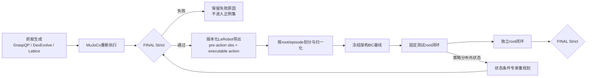

# 模仿学习闭环抓取研究路线审计

日期：2026-10-24  
审计范围：P0–P14、当前代码、配置、summary、checkpoint、视频及 Git 状态  
审计性质：只读证据审计；本轮未运行训练、闭环实验或实机程序，未修改控制与物理代码

## 1. Executive Summary

项目仍然围绕“自动生成严格验证示教，再通过模仿学习完成可部署闭环抓取”这一主线。当前并非缺少模型种类：BC、ACT、Diffusion Policy（DP）、GRU、全局视觉与 ROI 分支都已有真实实现和 checkpoint。真正尚未闭合的是：**成功专家分布与学习策略实际访问状态之间缺少可验证、状态匹配的监督数据**。

证据链如下：

1. P2 已确认并修复旧 LeRobot 数据的两个合同错误：旧动作是 `xyz + quaternion + hand6`，模型却按 `arm7 + hand6` 解释；旧记录还把 post-action observation 与当前 action 配对。因此 P0/P1 旧 LeRobot 数据、旧 DP checkpoint 及其闭环数字不能作为有效性能基线。
2. 修复后的单轨迹专家数据可以逐维无误差往返，并在原物理条件下完成 Lift；说明基础动作链路和 MuJoCo 执行不是当前首要阻塞。
3. 修复后 BC、ACT、DP 的固定初态实验均未完成 Lift。BC 已能 Approach 和形成接触，但在 Close/Hold 后失稳。P5 的交叉控制进一步证明主要瓶颈来自 arm/腕部闭环漂移：`Expert arm + BC hand` 为 4/4 Lift，`BC arm + Expert hand` 为 0/4。
4. P6 的 XYZ9 连续 IK 合同可完成专家转换回放，且无 IK 失败或关节限位违规；因此 XYZ9 是可保留的工程基线，但“可回放”不等于“已学会闭环抓取”。
5. P8–P11 的历史模型、GRU、Supervisor、高分辨率与 ROI 能改善部分接触指标，但没有产生 Strict Lift。不能把问题归结为模型容量或图像分辨率。
6. P12–P14 从 5 个独立 BC root 做了 147 次有界接管/候选实验（P12 80、P13 40、P14 27），承载正例仍为 0。P14 发现 arm 分支从 step 1–2 即分歧、腕部 XYZ 从 step 5–20 持续分歧、hand6 从 step 37–40 持续分歧；BC 接触又比 Expert 提前。原 Expert 的按时间索引未来动作因此不再适合 BC 当前构型。

**主线选择：路线 B——重建“多独立初态、多成功抓取构型、状态覆盖明确”的高质量完整示教集。**

辅助路线最多保留两条：

- 路线 D：只在具备“从策略访问状态重新规划并严格验证”的专家后，做小规模 DAgger 式状态覆盖；当前先建设能力，不直接采失败轨迹作标签。
- 路线 C：数据门槛达到后，用分阶段评测和可部署切换条件建立基线；暂不以阶段拆分掩盖上游示教覆盖不足。

路线 A（继续从现有 BC Close 状态做相似局部搜索）应暂停。P12–P14 已超过 100 次针对该方向的受控试验且没有承载正例，继续增加同类预算缺少证据基础。

下一步最值得做的单个实验不是重新训练网络，而是：

> **为同一个 Sugar Box 固定测试协议生成至少两种不同成功抓取构型、每种覆盖多个独立初态的完整 FINAL_VERIFIED 轨迹，并验证这些轨迹在离线状态空间中确实覆盖现有 BC 最早分歧区域。**

只有该门槛通过，才重新导出数据并训练冻结架构的 XYZ9 BC。若数据覆盖改善后 BC 仍失败，再用同一数据比较历史 BC/ACT；DP 最后进入，因为其采样与连续性成本更高。

## 2. Git 与产物保护状态

### 2.1 Git 快照

| 项目 | 审计结果 |
|---|---|
| HEAD | `6be6a346fc4fbdf5f3fb42c1ea7c34cae7b6376f` |
| 当前分支 | `main` |
| 其他本地分支 | `experiment/grasp-v1` |
| `git status --short` | 审计前 84 项；工作区显著未收口 |
| tracked diff | 6 文件，530 insertions / 64 deletions |
| tracked 修改 | `apps/collect_generated_lerobot.py`、`apps/evaluate_diffusion.py`、`apps/train_diffusion.py`、`source/data/lerobot_recorder.py`、`source/imitation/dataset.py`、`source/imitation/diffusion_policy.py` |
| commit/push | 本轮均未执行 |

工作区中大量 P0–P14 应用、测试、报告和实验配置仍为未跟踪文件。它们构成当前研究证据，但尚未形成可审查的版本历史。后续开发前应先做“只纳入代码/配置/报告、不纳入大体积输出”的人工提交计划；本审计不代替该操作。

### 2.2 关键 checkpoint SHA-256

| Checkpoint | SHA-256 | 有效性 |
|---|---|---|
| P3 Joint13 BC | `bd94fb7180592163bb66e0fec0558a25e57a10655b9d0febf361638406dbff26` | 数据合同修复后，可作单轨迹诊断基线 |
| P3 ACT | `7391f8521326c14529a4fe1dbe44145617051f1f9d7b58a31bdf65ca559b8df0` | 数据合同修复后，可作单轨迹诊断基线 |
| P6 XYZ9 BC | `671a091347b1c8c2c8e06bcff8153cc3113b00541846713ef1b9dd4605718d9d` | 当前主基线；未完成 Strict Lift |
| P6 Pose12 BC | `d9176dbb6b5b5297b71f1558e7af9c5957504ec165ae2ac89fff9832948a5fa4` | 有效消融；闭环失败 |
| P8 GRU | `765d64fc310e662a91524c4b6814866310d2510d10cbb22ad4b96eca55dc796d` | Hold/Lift 时序诊断；不是完整抓取策略 |
| P11 Global BC | `2346c56cce1e5f57f015bb421bd4426bdb9dbd03ee1a23a9789692d78d1ca6c3` | 有效视觉消融；0/2 Strict |
| P11 Global+ROI BC | `78d5c601219496bc7ee4c04130064620c0d723d876db2cdddebaf703d6e25f12` | 有效视觉消融；0/2 Strict |
| P1 V+S DP | `7db093f0cda8774ebd158cd6a4c3b1cb98f563f2be3a3860ad033c1112159c14` | **语义无效，不作基线** |
| P1 V+T+S DP | `134084424c338fe200c46cda7973f21fefa3290c892034995020d22d4df3e47b` | **语义无效，不作基线** |

## 3. P0–P14 实验有效性矩阵

“保留”表示结果在其声明范围内仍有效；不表示已经完成最终抓取。

| 阶段 | 可保留成果 | 不能外推或已失效部分 | 决策影响 |
|---|---|---|---|
| P0 | 39D 可部署状态、episode-level split、可禁用 tactile、Strict 后导出流程 | 早期 5-episode 旧动作导出及 DP 1/2、0/2 | 保留 schema 思路，旧性能清零 |
| P1 | 90 次扰动执行中 46 次 FINAL_VERIFIED；Formal30 的 30 条源 manifest | Formal30 旧 LeRobot、两组 DP checkpoint、0/20 性能比较 | 源轨迹可重新导出；模型不可复用 |
| P2 | `arm7+hand6` 动作语义、pre-action 对齐、动作往返 RMSE=0、专家成功回放 | 无泛化策略成功 | 这是所有后续有效数据的最低合同版本 |
| P3 | 修复后 BC/ACT/DP 最小闭环、DP sampler bug 证据、自动生成成本审计 | 单轨迹结果不是泛化；DP 仍未 Approach | 模型结构不是唯一瓶颈 |
| P4 | 正确 160×120 输入、action_steps=4 基线、阶段失稳定位 | P3 480×640 的接触率不能作同分布基线 | 固定当前图像/执行合同 |
| P5 | arm/hand 交叉控制、110/116 稳定域、触觉约 0.2 s 预警 | recovery 混合训练造成 Approach 遗忘；不能称改进 | arm/腕部状态漂移为强证据 |
| P6 | XYZ9/Pose12 定义、连续 IK、专家笛卡尔回放；XYZ9 基线 | 末端表示没有使 BC 自动成功 | 保留 XYZ9，不继续无依据扩容 |
| P7 | XYZ9 可恢复性与触觉残差边界分析 | 未建立稳定完整 Lift | 触觉恢复暂非主线入口 |
| P8 | 10 个独立 Sugar roots、时序数据与 GRU 诊断 | 约 260 mm 抬升曾受终止/执行合同影响；GRU 不是完整策略 | 保留时序资产，先解决准备状态 |
| P9 | Supervisor、安全终止、5 个 root 的承载门槛与 0/40 结果 | 多指接触不等于承载 | 冻结承载门槛，防止伪成功 |
| P10-Vision | 1920×1080 渲染、预处理/ROI/成本审计 | 高清细节不等于控制收益 | 不优先扩大视觉模型 |
| P11 | ROI 提升 contact/multi-contact 的配对证据 | Global 与 ROI 均 0/2 Strict | 视觉不是已证实主因 |
| P12 | 完整 snapshot 精确恢复；40 接管+40 搜索均 0 | Expert 时间对齐接管不能视为重规划 | 需要状态条件专家 |
| P13 | 近成功候选 3/3 复现；40 次有界搜索 0/40 | follow 0.512 但 rise 2.384 mm，不是正例 | 停止 Close 静态偏移扩搜 |
| P14 | 5-root 最早分歧证据；27 次前移接管/搜索 0/27 | 尚未证明唯一根因 | 转向完整、多构型示教生成 |

## 4. 十项仓库证据审计

### 4.1 Git、阶段报告与实验资产

- **路径/证据**：`docs/progress/2026-10-11_dp_progress.md`、`2026-10-11_dp_p3_report.md` 至 `2026-10-24_dp_p14_report.md`；对应 `outputs/dp_*`。
- **事实**：P0–P14 报告、主要 summary、checkpoint、曲线和视频存在；P3、P4、P5、P6、P8、P9、P11–P14 均有实际闭环或诊断产物。
- **未确认假设**：所有历史命令能在当前未提交工作区完全重跑。当前代码与各阶段运行时状态没有 commit 边界，不能仅凭报告保证 bitwise reproduction。
- **影响**：下一阶段开始前必须冻结环境、代码 commit、数据 manifest 和 checkpoint hash；否则新旧差异难以归因。

### 4.2 示教生成入口及真实含义

- **完整生成**：`tools/grasp_generation/graspqp_evolve.py`，链路为 GraspQP → DexEvolve → Lattice/PPO → MuJoCo/Strict。
- **扰动生成**：`apps/generate_verified_lift_demonstrations.py::run`，基于已有成功 manifest，扰动物体/抓取目标、重新 IK、重新物理执行并 Strict 验证；不是只改 initial state 后重放。
- **LeRobot 导出**：`apps/collect_generated_lerobot.py::recorded_pre_action_indices`、`run`。
- **事实**：完整流水线支持 `object_id + seed`，但没有显式 initial pose 批处理接口；局部扰动成本远低于完整生成。P3 记录 Sugar 单次完整生成约 898.46 s，局部扰动每成功约 34.17 s。
- **未确认假设**：局部扰动能产生不同抓取拓扑。当前 Formal30 的 Sugar 10 条全部源自同一个 lattice manifest，小范围约 ±1 mm 扰动，不能视为 10 种独立抓法。
- **影响**：新数据目标应由“轨迹条数”转为“独立 root × 抓取构型 × 初态覆盖”的三维配额。

### 4.3 成功示教数量、物体分布与完整性

- **P1 搜索事实**：总计 90 次扰动执行，46 次 FINAL_VERIFIED。
- **Formal30 事实**：`outputs/dp_p1_2026-10-11/formal30_selection.json` 明确选择 30 条：Sugar Box 10、Potted Meat Can 10、GSO Shredder 10；均有不同 seed/扰动和 FINAL strict 信息。
- **完整性事实**：这些源 manifest 是完整成功轨迹，包含初始状态、控制和 Strict 指标；它们本身仍有效。
- **关键限制**：Formal30 是 3 个物体各 10 条，不是原计划的 5 个物体；Sugar 十条来自同一基础抓取构型，扰动幅度很小。P8 的 10 个 Sugar roots 为时序 Hold/Lift 研究资产，不自动等于 10 条适合端到端策略训练的多构型示教。
- **影响**：数量“30”不能掩盖有效模式数很少。应先做去重与覆盖审计，再决定补多少数据。

### 4.4 LeRobot observation/action/时间/划分/归一化

- **状态合同**：`source/imitation/observation.py::real_observable_state`；`DP_STATE_SCHEMA = actuator_position_velocity_command_v1`。13 个执行器的 measured actuator position、velocity、last command 拼为 39D，不含物体自由关节。
- **动作合同**：同文件 `validate_position_action_contract`；Joint13 为 arm7 absolute joint target + hand6 target。XYZ9/Pose12 在 `source/imitation/cartesian_action.py` 使用独立 schema。
- **数据集**：`source/imitation/dataset.py::LeRobotDiffusionDataset.__getitem__`；按 episode 边界取 horizon 并末值 padding，不跨 episode。
- **划分**：`apps/train_diffusion.py::split_episode_indices`；episode-level，而非 frame-level。
- **归一化**：`apps/train_diffusion.py::moments` 从 train indices 计算；模型 checkpoint 保存 state/tactile/action moments并反归一化输出。
- **记录对齐**：P2 后 `collect_generated_lerobot.py` 恢复/读取 pre-action 状态并与 strict executable control 配对。
- **事实**：P2 单轨迹往返动作逐维误差为 0，修复后的专家回放成功。
- **未确认假设**：所有历史 LeRobot roots 都在 P2 后重建。事实相反：P1 正式 DP 使用的是旧导出，因此必须按数据 root 单独标注版本，不能凭 schema 名称猜测。
- **影响**：任何新训练前先运行 dataset provenance validator，并拒绝缺少 source manifest、export contract version、pre-action alignment proof 的 root。

### 4.5 模型、checkpoint 与闭环入口

| 方法 | 实际定义/训练/评估 | 实际模态 | 有效闭环结论 |
|---|---|---|---|
| Deterministic BC | `source/imitation/action_chunk_bc.py`; `apps/train_action_chunk_bc.py`; `apps/trace_action_chunk_bc.py` | RGB + 39D state | P4 最优 contact 240/340，max 8.29 mm，Lift 失败 |
| XYZ9/Pose12 BC | `source/imitation/cartesian_action.py`; `apps/train_cartesian_action_chunk_bc.py`; 对应 trace | RGB + 39D state | XYZ9 为当前基线；Pose12 contact 279/340但最终掉落，均未 Strict |
| ACT | `apps/train_act_single.py`; `apps/trace_act_rollout.py`; LeRobot `ACTPolicy` | RGB + 39D state | P3 单轨迹 contact 165/340，max 2.69 mm，失败 |
| DP | `source/imitation/diffusion_policy.py`; `apps/train_diffusion.py`; `apps/evaluate_diffusion.py` | V+S 或 V+T+S | P1 正式 checkpoint 无效；P2/P3 单轨迹修复 sampler 后仍失败 |
| GRU | `source/imitation/lift_temporal.py`; `apps/train_lift_temporal_controller.py`; `apps/evaluate_lift_temporal_controller.py` | 机器人 state/action history，不是完整 RGB 抓取策略 | 能记忆部分 Hold/Lift，不能从 BC 非承载状态建立抓持 |
| Global+ROI BC | `source/imitation/dual_vision_bc.py`; dual-vision dataset/train/eval | 全局 RGB + ROI + state | 接触提高，但 held-out 0/2 Strict |

- **容量证据**：既有审计统计 XYZ9 BC 约 1.861M、ACT 约 12.319M、DP V+S 约 2.337M、V+T+S 约 2.586M 参数；更大模型没有对应的完整 Lift 优势。
- **影响**：当前无证据支持“先扩容”。新模型只应在同一新数据和固定评测协议下进入消融。

### 4.6 Expert 是重规划器还是定时轨迹播放器

- **事实**：完整抓取生成器能够从一个新的 reset/seed 生成并验证整条轨迹；扰动生成器能围绕已知技能对物体变换后重新 IK 和执行。
- **事实**：P12–P14 所称 Expert 接管主要是将原成功轨迹按时间/最近状态对齐后续接，不是一个已验证的、从任意 BC 接触状态重新规划的在线专家。
- **事实**：同一个 Expert future 在 Expert 自身状态成功，在 BC 状态 5 roots 的接管与局部搜索没有承载正例。
- **未确认假设**：GraspQP/Lattice 能否直接以包含接触的任意 BC snapshot 为初态生成新成功轨迹。当前 CLI 和报告没有证明这一能力。
- **影响**：不能立即做标准 DAgger；首先要实现/证明“策略状态 → 新完整物理规划 → Strict 成功”的离线专家查询。

### 4.7 成功与失败示教如何处理

- **事实**：正式 generated LeRobot 导出默认要求 `strict_replay_manifest(..., FINAL_PROFILE)` 成功；未验证轨迹只在显式 `--allow-unverified` 下进入诊断导出。
- **事实**：P1 失败候选保存在 summary 并分类，不进入 Formal30。
- **事实**：P5 recovery dataset 只包含通过其双回放/阈值的 15 条局部恢复轨迹，但这些并非完整端到端 FINAL_VERIFIED；直接混合后造成 Approach 遗忘。
- **未确认假设**：失败轨迹是否可用于负样本、readiness 或序列价值学习。当前没有经独立 root 验证的标签协议。
- **影响**：端到端 BC 只用完整 FINAL_VERIFIED 正例；局部正例必须带阶段/起点/验证级别，不能与完整示教等权混合。失败数据先用于诊断，不自动提供正确动作标签。

### 4.8 Vision、State、Tactile 是否真正参与

- **Vision**：BC/ACT/DP/P11 的训练和推理实际读 RGB；P4 已修复训练 160×120、推理误用 640×480 的不一致。P10/P11 显示更高清或 ROI 可增加视觉细节/接触，但未证明 Strict 收益。
- **State**：39D 在 BC/ACT/DP 推理均实际拼接使用；不含物体真值。
- **Tactile**：仅 DP V+T+S 路径通过 tactile encoder 实际使用 712D；`--no-tactile` 时 tactile_dim 为 0。当前有效的 XYZ9 BC、ACT、GRU、P11 主结果没有触觉策略输入。P5 的触觉仅作为离线预警诊断。
- **事实**：现有有效实验没有证明 tactile 提高 closed-loop Strict success。
- **影响**：触觉消融必须等无触觉基线能在多个独立 root 完成闭环后再做；否则 0 对 0 无法回答触觉贡献。

### 4.9 Strict、承载门槛、Supervisor 与终止

- **Strict**：`source/verification/strict_replay.py::strict_replay_manifest` 与 `source/verification/profiles.py`。FINAL profile 检查约 55 mm 的尾段/最终抬升、速度、角速度、接触、对向性、桌面接触和穿透等。
- **承载诊断**：P9 冻结为探测过程中 object-following ratio ≥0.5 且物体实际上升 ≥3 mm，并同时记录接触/对向/桌面接触；`PREPARATION_VALIDATED` 不等于 `FINAL_VERIFIED`。
- **Supervisor**：`source/imitation/lift_supervisor.py`，以可部署机器人状态执行 lift/hold/停止；后续仍须离线 Strict 判定。
- **在线环境**：研究 rollout 通常 `terminate_on_success=False`，避免瞬时 task signal 提前掩盖尾段稳定性；Supervisor 的安全停止也不等于 Strict 成功。
- **事实**：三者是层级关系，不是同一判据。P13 最佳 follow 0.512 但 rise 2.384 mm，正确判为未通过。
- **未确认假设**：真实机器人可提供与仿真 Supervisor 完全等价的 wrist/state 时序及停止反馈；需与外部实机程序确认。
- **影响**：继续保持 `CONTACT_ESTABLISHED → PREPARATION_VALIDATED → FINAL_VERIFIED` 三层，不得用接触数替代承载或 Strict。

### 4.10 推理延迟与控制频率

- **事实**：Joint BC P4 P95 约 4.79 ms；P3 ACT P95 约 30.67 ms；修复后 DP DDIM10 P95 约 17.50 ms，DDPM50 约 42.88 ms。控制周期为 50 ms（20 Hz）。
- **事实**：这些仿真测量表明 BC/ACT/DDIM10 不因纯推理计算超出 20 Hz；DP50 接近周期上限。
- **未确认假设**：真实相机、触觉、总线、IK 和安全层加入后的端到端延迟。
- **影响**：当前闭环失败不是由已测 GPU 推理延迟单独解释；实机前仍需端到端 watchdog 与延迟预算。

## 5. 核心研究链路审计

| 环节 | 已完成且有效 | 未打通 | 上游对下游的影响 | 下一证据 |
|---|---|---|---|---|
| 示教生成 | 可从 object+seed 完整生成；可做有界扰动重求解 | 抓取构型多样性不足；不能从任意 BC 接触状态重规划 | 同源微扰使策略只学一条窄流形 | 多基础 grasp ID、独立 root 的覆盖统计 |
| 数据验证 | FINAL strict、失败分类、snapshot/manifest | 局部 recovery 与完整 success 的统一 provenance 尚弱 | 局部片段混入会造成阶段遗忘 | 每条样本的 source/root/stage/verification 标签 |
| 数据合同 | P2 后 39D/Joint13、XYZ9、pre-action 对齐、episode split | 历史 root 未全部版本化 | P1 模型与指标失效 | 自动拒绝旧 schema 的 dataset audit |
| 模仿训练 | BC/ACT/DP/GRU 均真实运行 | 没有在多 root 完成端到端 Lift | 换模型无法补不存在的状态监督 | 同一高质量数据先训冻结 XYZ9 BC |
| 闭环执行 | 连续 IK、chunk、Supervisor、视频与逐步诊断 | Close/Hold 承载构型失败；策略状态偏离专家 | 离线 loss 对闭环解释力有限 | 新旧数据配对闭环，不改阈值 |
| Strict 成功 | 专家源轨迹可 FINAL_VERIFIED | 学习策略尚无可信独立 root FINAL | 无最终论文主指标 | 固定 root 清单上的成功数/总数 |
| 独立初态泛化 | P8/P9/P11/P12–P14 有独立 roots 诊断 | 学习策略 0 个完整 Strict 泛化成功 | 当前不能声称泛化 | 至少 5 个 held-out roots，后扩 20 |

### 瓶颈排序

1. **示教状态覆盖/抓取构型多样性不足，以及缺少对策略访问状态的可验证专家动作。** 这是 P12–P14 的直接证据。
2. **闭环分布漂移。** BC 的 teacher-forced 误差很低，但从早期 arm/腕部分歧逐步形成不同接触拓扑。
3. **示教数据 provenance 与版本化不足。** P2 已修复合同，但历史 root 混存使结果容易误用。
4. **模型预测与 chunk 连续性。** 确实存在，但 BC/ACT/DP 都失败且扩容/时序/视觉没有解决，不能列为首因。
5. **触觉使用不足。** 是后续论文变量，不是当前无承载正例的首要修复工具。
6. **推理延迟。** 仿真 BC 基线远低于 50 ms，不是当前主瓶颈。

## 6. 四条候选路线比较

### 路线 A：继续局部修复现有 BC

| 项目 | 审计结论 |
|---|---|
| 解决问题 | 从 BC 真实状态恢复到可承载构型 |
| 现有证据 | P12 80、P13 40、P14 27 次均无承载正例；定时 Expert future 与 BC 状态不兼容 |
| 最小实验 | 仅当出现新的“状态条件重规划器”时，对 2 个 root 各最多 5 次查询；不再搜相似静态 offset |
| 预期 | 若专家能从 BC 状态生成 FINAL 轨迹，才证明路线可行 |
| 成本 | 重规划接口中高；同类手工搜索低但预期收益极低 |
| 风险 | 继续对单 root 过拟合、形成无法泛化的补丁 |
| 成功门槛 | 至少 2/2 不同 roots 有 PREPARATION，且至少 1 条 FINAL；随后在未调参 root 复现 |
| 失败决策 | 任何一个 root 在固定 5 次状态条件查询仍无可行解，暂停该起点，回到更早完整规划 |
| 是否训练 | 否；先证明局部专家存在 |

**优先级：暂停，作为路线 D 的能力测试而非独立主线。**

### 路线 B：重建高质量多样化完整示教集

| 项目 | 审计结论 |
|---|---|
| 解决问题 | 同源微扰、抓取拓扑单一、独立初态覆盖不足 |
| 现有证据 | Formal30 每物体 10 条但 Sugar 同一基础 lattice；BC 很早离开专家流形 |
| 最小实验 | 先只做 Sugar：2–3 个基础抓取构型 × 每构型 5 个独立 roots；全部重新执行并 FINAL strict；留 5 个独立 roots 测试 |
| 预期 | 训练集状态/动作覆盖扩大，策略早期分歧降低，Close 接触时序不再系统提前 |
| 成本 | 中等；完整生成约 15 min/成功，局部严格重执行约几十秒/尝试，可混合调度 |
| 风险 | 多构型标签可能产生多模态；生成器可能仍偏向同一拓扑 |
| 成功门槛 | ≥15 条完整 FINAL、≥2 个可区分 grasp IDs、train/val/test root 不交叉；新 BC 在固定 root 至少 1 次 FINAL，held-out 5 roots 至少 2/5 FINAL 才进入扩展 |
| 失败决策 | 若专家多构型存在但 BC 仍 0/5，转 ACT/历史模型；若生成器无法得到第二构型，先改示教生成而非训练 |
| 是否训练 | 数据门槛后先只训冻结 XYZ9 BC，一次 seed 的有界实验 |

**优先级：主线。**

### 路线 C：分阶段模仿学习

| 项目 | 审计结论 |
|---|---|
| 解决问题 | Approach 与 Close/Hold/Lift 的动力学和观测需求不同，避免局部 recovery 混合破坏 Approach |
| 现有证据 | P5 recovery 混合导致 Approach 遗忘；GRU 可记忆 Hold/Lift，但 BC 准备状态不承载 |
| 最小实验 | 在完整新示教上离线标注阶段；冻结 Approach BC，只训练 Close/Lift head；在线切换仅用机器人 state、历史动作和触觉/图像可部署特征 |
| 预期 | 保留 Approach，同时隔离 Close/Lift 优化 |
| 成本 | 中等；需要无 oracle 的切换验证 |
| 风险 | 阶段切换本身引入跳变；离线物体真值标签泄漏到在线逻辑 |
| 成功门槛 | 固定 root 无切换跳变、至少 1 次 FINAL；held-out roots 优于统一 BC 且同阈值 |
| 失败决策 | 若准备状态仍不承载，停止训练切换器，回到示教构型 |
| 是否训练 | 仅在路线 B 数据具备后，作为辅助消融 |

**优先级：辅助二。**

### 路线 D：历史观测与 DAgger 式分布修正

| 项目 | 审计结论 |
|---|---|
| 解决问题 | 策略访问训练分布外状态、单帧难以辨识接触趋势 |
| 现有证据 | P4/P14 有明确闭环漂移；P5 触觉在 arm error 前约 4 步变化；但当前没有任意状态专家 |
| 最小实验 | 收集冻结 XYZ9 BC 的最早分歧 snapshot；离线调用新专家重新生成完整轨迹；只纳入 FINAL 轨迹，按 source root 分组 |
| 预期 | 直接覆盖策略访问状态，而非添加无关随机噪声 |
| 成本 | 高，主要是状态条件专家与验证成本 |
| 风险 | 专家查询失败；把失败动作或 oracle future 错当监督；root 泄漏 |
| 成功门槛 | 5 个查询 roots 中至少 3 个得到 FINAL；加入数据后同一 held-out 集 Strict success 提升，Approach 不退化 |
| 失败决策 | 查询成功率 <3/5 时，不训练 DAgger 数据，改为更早起点或完整再规划 |
| 是否训练 | 先否；专家门槛通过后才做一次增量 BC 对照 |

**优先级：辅助一，但先建设专家查询，不立即训练。**

## 7. 恢复模仿学习主线的八个回答

1. **是否冻结当前 XYZ9 BC？** 是。冻结 checkpoint `671a...d9d`、图像 160×120、action_steps=4、20 Hz、连续 IK 和测试 roots，作为失败但可复现的基线。不要继续在它上面无界调参。
2. **先修数据还是换模型？** 先修/重建示教覆盖。现有 BC、ACT、DP、GRU 和 ROI 的共同失败已经说明换模型不是最低成本的因果实验。
3. **完整成功轨迹还是 BC 状态局部示教？** 主体从多构型完整 FINAL 轨迹重建；同时把 BC 最早分歧 snapshot 用作覆盖审计。只有状态条件专家能从该 snapshot 重新规划并完成 FINAL 时，才加入局部 DAgger 数据。
4. **如何避免新示教破坏 Approach？** 按 root 和来源分层采样；保留完整旧成功轨迹；局部片段不直接等权混入端到端数据；先做 replay buffer 比例消融（100:0 与 75:25），并以 Approach 到达率为硬性非退化门槛。
5. **何时 BC、ACT、DP？** 新数据达到 ≥15 FINAL、≥2 grasp modes、无 root 泄漏后先训同结构 XYZ9 BC。若 BC 在固定 root 有成功但 held-out 差，尝试历史/ACT；若动作明显多模态且 ACT 仍不足，再试 DP。DP 不应先于可靠数据基线。
6. **如何证明独立初态改善？** 训练前冻结 test manifest/seed/root 哈希；同一物理参数、Strict profile、最大步数和 Supervisor；报告 successes/attempts，禁止用训练 roots、挑选成功 seed 或改阈值。
7. **如何比较 V+S 与 V+T+S？** 在无触觉策略已有非零 held-out Strict success 后，使用完全相同 episodes、split、seed、容量预算与 test roots，只切换 tactile encoder；同时报告接触前/后分段和延迟。此前的 P1 0/20 对比无效。
8. **何时做 readiness、域迁移和实机？** readiness 需多个独立 roots 的 PREPARATION 正负例；触觉 GAN 需仿真/实机成对或可对齐的原始传感数据合同；实机策略部署需仿真 held-out Strict 非零且安全接口确认。GAN 数据采集与接口设计可并行准备，但不应阻塞仿真闭环。

## 8. 有门槛的下一阶段计划

### Stage 0：证据与数据版本冻结（0.5–1 天）

- **目标**：消除历史 root/动作合同混用。
- **基线**：P2 fixed single Sugar、P6 XYZ9、P14 5 roots。
- **变量**：无。
- **固定测试集**：先登记 5 个 held-out Sugar root manifest/seed/hash。
- **预算**：只读检查与 validator；不训练。
- **成功标准**：每条轨迹有 source manifest、root ID、base grasp ID、schema、pre-action proof、Strict JSON、hash。
- **停止条件**：发现 provenance 缺失则该轨迹不进入新数据集。
- **失败决策**：从源 manifest 重导出，不修补旧 parquet。
- **交付**：dataset inventory JSON、frozen test roots、审计报告增补。

### Stage 1：多构型完整示教最小集（主实验，固定预算）

- **唯一目标**：证明生成器能提供不同成功抓取构型，而不只是同轨迹微扰。
- **基线**：Sugar 现有 base lattice grasp。
- **变量**：base grasp ID（至少 2）和独立 initial root；暂不改物理。
- **固定测试**：每个候选均完整 MuJoCo 执行 + 原 FINAL Strict。
- **预算上限**：最多 3 个 base grasps × 8 roots = 24 次被选候选；完整生成最多 6 次，其余用已验证 base 做有界变换。
- **成功标准**：至少 15 条 FINAL、2 个不同 base grasp IDs、每 mode 至少 5 roots；腕轨迹/接触顺序去重后仍为不同 mode。
- **停止条件**：连续 8 次新 base 尝试仍只回到同一拓扑，停止生成并审计 GraspQP/Lattice 多样性约束。
- **失败决策**：修改示教候选多样性/排序，不训练模型。
- **交付**：`outputs/.../demonstrations/`、manifest、coverage plots、失败分类、视频。

### Stage 2：数据覆盖与 BC 分歧配对审计

- **唯一目标**：确认新示教覆盖 P14 的 step 1–40 分歧区域。
- **基线**：旧单 mode 数据与冻结 XYZ9 BC rollout。
- **变量**：旧数据 vs 新多 mode 数据，仅做离线近邻/覆盖比较。
- **测试集**：P14 的 5 个 root 分歧 snapshots。
- **预算**：不训练；固定 KNN/轨迹距离分析一次。
- **成功标准**：至少 3/5 roots 在新数据中存在动作/状态连续且最终 FINAL 的邻近轨迹；接触时序覆盖 Expert 与 BC 两侧，而非全为同一早闭合模式。
- **停止条件**：覆盖没有改善。
- **失败决策**：补状态条件示教，不进入模型训练。
- **交付**：coverage matrix、nearest-success videos、root leakage check。

### Stage 3：冻结架构 XYZ9 BC 的唯一重训

- **唯一目标**：检验“更好示教覆盖”是否改善完整闭环。
- **基线**：P6 XYZ9 checkpoint/config。
- **变量**：旧数据 vs 新数据；架构、训练预算、seed、图像、action_steps、IK 全冻结。
- **测试集**：1 个固定诊断 root + 5 个预先冻结 held-out roots。
- **预算**：1 seed，预先固定 epoch/early-stop；不扩容、不训 ACT/DP。
- **成功标准**：固定 root 至少 1/3 FINAL；held-out 至少 2/5 FINAL；Approach 到达率不低于旧 BC；所有比例给分子/分母。
- **停止条件**：验证损失稳定且闭环仍 0/5，或 Approach 明显退化。
- **失败决策**：若开环误差好但早期漂移仍在，进入 Stage 4 DAgger；若多模态平均明显，进入 ACT 消融。
- **交付**：checkpoint/hash、loss、闭环逐步日志、Strict manifests、失败视频。

### Stage 4：状态条件专家/小规模 DAgger（条件执行）

- **唯一目标**：为冻结策略真正访问的状态生成正确、可验证的后续动作。
- **基线**：Stage 3 最好 BC。
- **变量**：是否加入状态查询得到的 FINAL 轨迹。
- **测试集**：另 5 个 held-out roots，不与查询 roots 重叠。
- **预算**：5 个查询 roots，每 root 最多 3 次规划；无 FINAL 则不入集。
- **成功标准**：≥3/5 查询 roots 产生 FINAL；重训后 held-out Strict 相对 Stage 3 增加且 Approach 不退化。
- **停止条件**：<3/5 可查询，或所有解回到不可兼容时间轨迹。
- **失败决策**：把规划起点前移，或回到完整生成器；不把失败 rollout 作为 action 标签。
- **交付**：query provenance、before/after coverage、paired evaluation。

### Stage 5：模型与触觉消融（最后执行）

- **唯一目标**：在已有非零 BC success 的前提下回答时序模型和触觉是否增益。
- **基线**：Stage 3/4 XYZ9 BC。
- **变量**：BC vs ACT/历史 BC；V+S vs V+T+S，分别单变量比较。
- **测试集**：同一 20 个 held-out roots；至少 3 seeds 后才报告均值/方差。
- **预算**：先 1 seed smoke，通过后最多 3 seeds；DP 仅在 ACT/BC 暴露多模态瓶颈时进入。
- **成功标准**：Strict successes/attempts 提升，同时 drop、接触稳定、P95 不退化到不满足控制周期。
- **停止条件**：1-seed smoke 为 0 且失败阶段与基线无变化。
- **失败决策**：停止扩容，返回数据/专家覆盖。
- **交付**：公平消融表、模态输入证明、checkpoint、视频和统计。

## 9. 论文贡献与项目要求分层

### A. 核心主线必须完成

1. 版本化、可追溯且无 root 泄漏的完整 FINAL 示教集。
2. 至少两种成功抓取构型与多个独立初态，而非同一轨迹微扰计数。
3. 冻结 XYZ9 BC 在固定及 held-out roots 的非零 Strict Lift。
4. 失败阶段、承载状态、独立初态 successes/attempts 的可复现实验。
5. 若采用分阶段/DAgger，在线逻辑只用可部署观测。

### B. 增强论文、但不阻断主线

1. BC/ACT/DP 在同一有效数据集上的动作表示与时序消融。
2. Vision+State 与 Vision+Tactile+State 公平对照。
3. 触觉失稳预警、readiness 与有界 residual recovery。
4. 全局+ROI、模型容量和推理延迟分析。
5. 多物体、seen/unseen object 泛化。

### C. 项目验收必须完成、可后置但不能删除

1. 真实 RM75B/Dex Hand 接口字段确认、安全限速、限位、急停和 watchdog。
2. 实机技能验证与仿真—实机一致的数据记录。
3. **GAN 触觉域迁移**：先冻结 712-taxel 仿真 schema 与真实传感器映射；收集对齐/弱对齐的接触数据；建立不做迁移、统计匹配、GAN 三组基线；用下游 readiness/策略指标而非仅 GAN loss 评价。
4. 实机 DP/ACT 部署只在仿真闭环和安全接口均通过后进行。

依赖关系为：A 的可靠闭环基线 → B 的触觉增益实验 → C 的实机数据与 GAN 域迁移 → 最终实机策略验证。GAN 的接口与数据采集设计可提前并行，但模型训练不应抢占当前示教闭环资源。

## 10. 八个核心问题的最终结论

### 1. 当前项目是否仍围绕模仿学习抓取？

是。示教生成、LeRobot、BC/ACT/DP/GRU、连续 IK、Supervisor 和 Strict 已形成完整研究框架；当前需要收敛的是数据与闭环证据，而不是另起新项目。

### 2. 真正瓶颈在哪里？

首要是示教分布/状态覆盖与闭环分布漂移的结合：成功 Expert 轨迹过于集中，且没有能从 BC 实际状态提供严格成功后续动作的专家。数据合同错误已在 P2 修复，但使 P1 结果失效；模型误差存在，却不是唯一或首要解释。

### 3. 哪些成果保留，哪些不能作基线？

保留 P2 后数据合同、Strict 源轨迹、XYZ9/连续 IK、P3–P14 的诊断结果、承载门槛和 Supervisor。P0/P1 旧 LeRobot、DP checkpoint 及其成功率不能作正式基线；局部 recovery 片段不能冒充完整 FINAL 示教；接触率不能替代承载或 Strict。

### 4. 下一步最值得做的单个实验是什么？

生成并验证 Sugar Box 的最小“多抓取构型 × 多独立 root”完整示教集，然后用 P14 snapshots 做覆盖审计。未通过覆盖门槛前不训练。

### 5. 需要什么示教才能推进？

需要完整 Approach→Close→Hold→Lift→Verify、FINAL_VERIFIED、pre-action 对齐、来自至少两种真实不同 grasp modes、覆盖多个独立 roots 的轨迹；进一步需要从策略最早分歧状态重新规划得到的 FINAL 轨迹，而不是原 Expert 的定时 future。

### 6. 何时重训，何时停止局部搜索？

达到 ≥15 FINAL、≥2 grasp modes、覆盖至少 3/5 BC 分歧 roots 后，重训一次冻结 XYZ9 BC。相似 Close offset 搜索现在应停止；只有新的状态条件专家存在时才恢复每 root ≤5 次的查询实验。

### 7. 触觉与 GAN 如何安排？

触觉策略消融在无触觉 BC 已有非零 held-out Strict 后进行。GAN 域迁移属于必须完成的项目要求：现在先确定真实/仿真 schema 和采集协议，主线闭环稳定后训练与评价，不永久推迟，也不让其阻断当前闭环。

### 8. 到可复现完整仿真抓取的最短可信路线是什么？

冻结现有合同与测试集 → 生成少量多构型完整 FINAL 示教 → 证明覆盖 BC 最早分歧状态 → 用相同 XYZ9 BC 做单变量重训 → 固定 root 验收 → 5 个 held-out roots Strict → 必要时状态条件 DAgger → 最后才比较 ACT/DP 与触觉。该路线最少改变变量，也最直接检验“示教覆盖是否导致闭环失败”。

## 11. 本轮改动与未执行事项

- 新增本审计报告。
- 未修改任何模型、控制器、数据集或 checkpoint。
- 未运行训练、闭环、Strict、pytest 或 Ruff；本轮没有代码改动需要回归测试。
- 未 commit、未 push、未运行实机。

