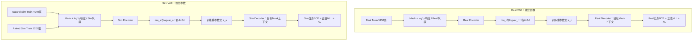
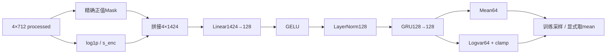
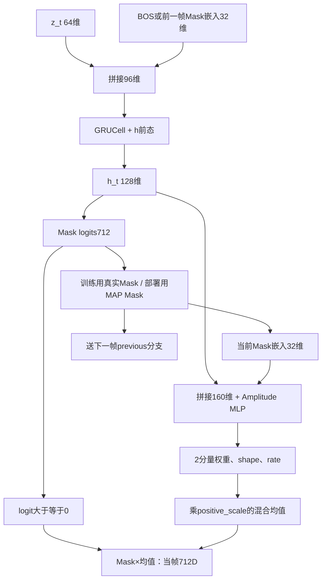

# Dual-VAE结构与完整数据流

代码根C3：`outputs/tactile_p43_c3_dictionary_inverse_c0_2026-11-16/code/`。L2依据为models.py、pipeline_cpu.py、inference.py及实际Checkpoint张量键/形状；未构造模型或运行forward。本轮静态读取见checkpoint_metadata.json、code_locations.json。

## 1. 双域对象与数据角色

pipeline_cpu.py第27–28、53行分别调用train_vae，分别实例化DomainVAE、创建AdamW及优化器状态。两个对象没有共享Encoder、Decoder、尺度buffer或联合训练损失。构造类相同，参数独立；每个模型1,094,232参数，其中Encoder298,240、Decoder795,992。两个Encoder都给出4×64的mean/logvar，不等于同一语义坐标。

Real VAE仅用Real Train。Sim VAE用Natural Sim Train与5.3构建的Paired Sim Train，二者进入**同一个Sim Encoder/Decoder**。Sim VAE自重建目标仍是对应Sim输入，不把对应Real窗口混作Sim自重建标签。Paired的Real目标只在后续Translator阶段提供跨域监督。

两个训练分支间没有MMD、CORAL、GRL或共享Stage Head。两域标签、Session/Root和阶段名不作为该Encoder输入。不能混用早期4×32联合VAE、P40共享Encoder或其辅助头解释C3。

## 2. Encoder逐层合同（models.py第7–12行）

|步骤|输入→输出|实际操作|
|---|---|---|
|原输入|[B,4,712]|非负processed响应；4个保留帧索引|
|激活结构|[B,4,712]|M=1[X>0]，不是人为调阈值后的Mask|
|幅值输入|[B,4,712]|log1p(X)/s_enc；s_enc是域内Train拟合的单一标量，不减均值|
|拼接|[B,4,1424]|Mask在前、幅值在后|
|Linear|1424→128|对各帧特征作用|
|GELU、LayerNorm|[B,4,128]|LayerNorm(128)；它与输入Scale是不同机制|
|GRU|128→128|单层、单向；Checkpoint只有l0，无reverse权重；输出全部4帧，不只取末隐状态|
|Mean头|128→64|每帧mu，[B,4,64]|
|Logvar头|128→64|每帧logvar，再clamp至[-8,4]|
|训练采样|[B,4,64]|z=mu+exp(logvar/2)·epsilon，epsilon为randn_like(mu)|

Encoder没有传入跨窗hidden state；每个4帧窗口独立开始，不构成对整个Episode的持续记忆。GRU的时间输入是帧序号，不含真实时间间隔；不能由结构本身证明已对齐Real不等间隔采样与Sim 20Hz。

**latent维度**：64是每帧维数，4×64是每窗表示；把距离诊断中的展平256维写成模型256维单帧latent是不准确的。

## 3. Decoder逐层合同（models.py第13–28行）

每个窗口h初始化为零[B,128]。BOS为可学习32维参数（初始化零），不是外部阶段标签。t=0用BOS；t>0对上一帧Mask施加Linear712→32及GELU。该32维上下文与当帧z_t的64维拼接，经GRUCell(input96,hidden128)递推。

|模块|形状/参数|作用|
|---|---|---|
|previous|Linear712→32 + GELU|上一帧Mask上下文|
|BOS|可学习32维|每窗首帧上下文|
|cell|GRUCell96→128|时序递推|
|mask|Linear128→712|每Taxel一个Mask logit|
|current|Linear712→32 + GELU|当帧完整Mask上下文|
|amplitude|Linear160→128、GELU、Linear128→4272|128维h拼当帧32维Mask，输出712×6|
|Gamma参数|reshape[B,712,6]后split(2)|各2个mix logits、shape、rate|
|参数合法化|mix softmax；shape/rate softplus+float dtype eps|两分量均为正值Gamma分布|
|读出|hard Mask × s_pos Σω·shape/rate|MAP激活+幅值混合均值；不是Gamma抽样|

图中“训练用真实Mask”表示C3 NLL的上下文，不是训练没有预测Mask：Mask logits仍按BCE训练；run(z,target)内部还形成hard读出作有效性检查，但这不是其重建NLL的上下文来源。

### Mask的依赖边界

Mask在**时间上自回归**，上一帧整幅Mask影响下一帧h；不是早期逐帧独立Bernoulli。给定h_t时，当前帧712个logit的似然仍按Taxel因子化Bernoulli/BCE，没有Taxel内逐点自回归或明确空间邻接图。共享latent/隐状态可带来边际依赖，不应写成已实现完整物理空间联合分布模型。

### Amplitude与Mask的条件关系

Amplitude条件不仅有h_t，还包含当前完整712维Mask的嵌入，因此不是对每个Taxel独立做全局分位数匹配。两分量Gamma允许正值响应形状更灵活，但分量数2不保证分布必有两个峰，更不表示两种已认证接触模式。

推理hard=(logit>=0)，等价于sigmoid概率>=0.5。输出只在预测Mask为1处为正，没有人为再截断正值幅度；run检查finite/非负，异常时抛错。logvar截断和shape/rate数值下限是参数约束，不能误称为输出幅值截断。

## 4. 训练、验证损失与部署不是同一调用

- 训练：pipeline_cpu.py第39行model(x,sample=True)，随机latent；Decoder.nll显式传target，前帧与当帧条件Mask都是真值。
- 每Epoch监控Train/Validation：第21–26行model(x,sample=False)，latent取mu，但仍调用teacher-forced NLL。
- 自由重建/部署：posterior_mean或Encoder输出mu，再deterministic_decode(z)，run(z,target=None)使用预测前帧/当前Mask，输出四帧混合均值。
- **model.eval()本身不会自动使forward取mean**：DomainVAE.forward默认sample=True，实际取mean由显式sample=False或posterior_mean接口保证。

因此，teacher-forced验证Loss不等于自由运行重建误差；同域重建也不证明跨域映射。C13与C24具体变化见版本报告，不能回填到原C3架构中。
