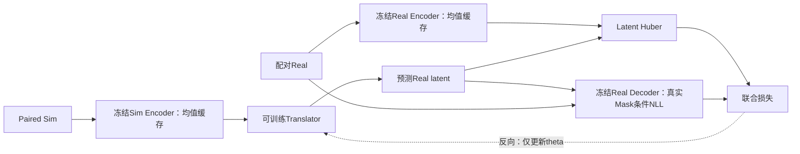

# Translator结构、变量语义与真实梯度路径

日期：2026-11-21。C3=`outputs/tactile_p43_c3_dictionary_inverse_c0_2026-11-16/`。L2静态代码与Checkpoint核对，不实例化网络、不执行forward/backward。

## 1. 网络逐层合同

源：C3/code/models.py:34–36，class Translator。

|模块|输入→输出|实际设置|
|---|---|---|
|输入|[B,4,64]|Sim Encoder posterior mean，不是随机重参数化latent|
|GRU第0层|64→128|单向，输入batch_first=True|
|GRU第1层|128→128|单向，层间传递隐序列；没有显式dropout|
|Linear|128→64|逐帧投影，带bias，无额外激活/归一化/残差|
|输出|[B,4,64]|预测Real坐标中的latent，不是712D触觉|

不传h0，PyTorch GRU使用零初态；4帧内部有隐状态递推，窗口/batch之间没有传递持久状态。未显式指定双向，权重无reverse键。GRU内部本身含门控激活，所谓“无额外激活”仅指GRU之外没有追加激活层。

Checkpoint形状：GRU layer0 input权重[384,64]、hidden权重[384,128]、两bias各[384]；layer1 input/hidden权重各[384,128]、两bias各[384]；projection权重[64,128]、bias[64]。参数量=74496+99072+8256=**181824**，逐Tensor形状/numel见checkpoint_metadata.json。

## 2. 五种变量不得混淆

- z_s=mu_s(x_s)：Sim Encoder均值，训练映射输入。
- z_r=mu_r(x_r)：同一伪配对Real窗口的Real Encoder均值，回归目标。
- VAE训练中的mu+sigma*epsilon：用于此前域内VAE训练，Translator阶段不再用此随机样本。
- z_hat_r=T_theta(z_s)：Translator输出，坐标意义由Real目标监督建立。
- x_hat=D_r(z_hat_r)：完整4×712读出，部署使用预测Mask与Gamma混合均值。

两VAE均值预提取于pipeline_cpu.py:57–59的inference_mode，不更新Encoder。训练用的是固定配对坐标的回归，不能把未映射的z_s、z_r直接解释成同一语义空间中的向量。

## 3. 训练目标与梯度

源：pipeline_cpu.py:54–70、models.py:18–33。

$$\widehat Z_r=T_\theta(\mu_s(X_s)),\qquad
L_H=\frac1{B\cdot4\cdot64}\sum_{n,t,d}\rho_1(\widehat z_{r,ntd}-\mu_{r,ntd}),$$

其中rho_1(e)=e²/2（|e|<1），否则|e|−1/2。F.huber_loss未指定delta或reduction，使用delta=1、reduction=mean。

$$L=L_H+0.1\frac1B\sum_n L_{D_r}(\widehat Z_{r,n},X_{r,n}).$$

L_Dr为Decoder.nll返回的第0项：按4×712平均的Mask BCE，加按每窗真实正值数量平均的Gamma混合NLL（含尺度Jacobian）。不是单独正值幅值NLL，不含VAE KL。无其他显式正则损失；AdamW另有weight_decay=1e−4，不能称完全无参数正则。

Decoder.nll(z,target)调用run(z,target)：前帧和当帧上下文均使用真实Mask，故为Teacher Forcing。硬Mask比较虽用于内部输出/合法性检查，但不在所优化NLL的可微数值路径上；不能误称训练通过硬阈值求导。幅值似然及Mask logits都可对z求导。

参数冻结与梯度阻断不同：Real Decoder参数requires_grad=False，但训练调用没有包no_grad，也未对预测z执行detach，故∂NLL/∂z·∂z/∂theta仍可回传。Encoder均值缓存无梯度，Sim Decoder不在Translator目标路径。梯度裁剪作用于T.parameters，范数5；优化器也仅包含T参数。

这是代码计算图核验，不是本轮新反向数值实验；不能冒称已L3检查每一梯度值。

## 4. 推理接口

C3/code/inference.py:7–19：Natural processed[ B,4,712 ]→Sim posterior_mean→T→Real deterministic_decode→[B,4,712]。输入转float32并检查shape、finite、非负；batch默认64，空输入返回空副本。无latent独立归一化，也不需要GMM、探针、Real样本或域标签；Sim Decoder不用于最终生成。

Translator本身训练/推理结构一致，均用均值序列；变化在Real Decoder：训练真Mask条件NLL，部署预测Mask自由递推与正值混合均值。推理全链使用inference_mode，训练阶段冻结Decoder仍保留到T的梯度。

## 5. GRU采用依据

时序GRU使第t帧映射可依赖当前与前序latent，适配4帧输入。没有在本次指定C3材料中发现相同数据、损失、预算及规模下GRU与MLP/逐帧映射的公平消融。不得据门控结构宣称已证实优于MLP、最优或解决所有接触时序问题。其他实验中不同协议的网络不构成此消融。
