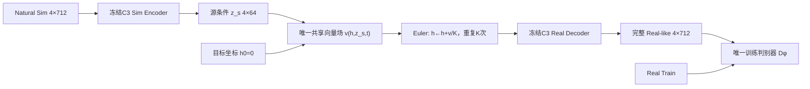

# P44架构与实际数据流

- v=T_C3(z_s)+CorrectionGRU(h,z_s,t)。T_C3在v内部，不是独立前置G0，不先生成触觉再修正。
- Correction投影零初始化；K=1第一步就继承完整跨域映射。h0不是独立Sim latent。
- 四帧是触觉时间轴；K是潜状态Euler积分步数。二者不能混淆。
- 最终G包含两个完整VAE以保留双域模块；部署只调用Sim Encoder、共享field、Real Decoder，Real Encoder和Sim Decoder不在部署路径中。
- Real/Sim两个原VAE全部冻结，流场及唯一D更新。每个K均引用相同模型参数。
- GMM仅通过原C3伪配对训练过的Translator及训练期C3教师间接继承，本轮没有额外GMM损失或跨独立latent的OT。

## 梯度合同

Decoder前向为原硬MAP Mask×Gamma混合均值。训练时使用hard+(p−stopgrad(p))的替代梯度，前向与原Decoder逐位一致，Smoke已核验；正式推理完全使用原deterministic_decode。

当前D将输入拆为exact-positive Mask和log1p幅值。后者可回传到G，前者的x>0是离散操作、不可回传。这是本配置的重要梯度缺口，见gradient_path_audit.json，不能隐去或将其简单归咎于模型容量。
