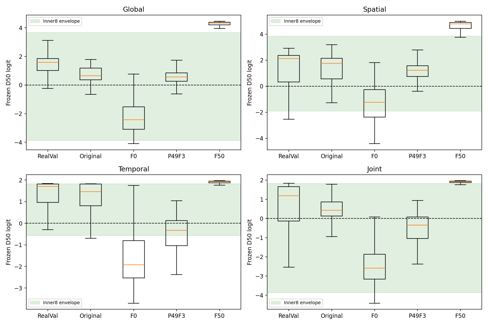
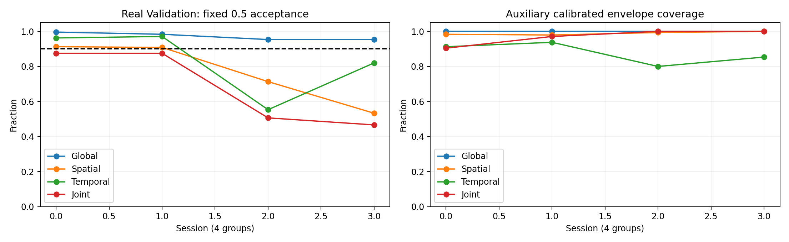

# P51：冻结D50可信度与Real分数包络审计

日期：2026-11-19。仅冻结推理和统计，训练/Optimizer Step均为0。

## 1. 决策

**NO-GO：D50不满足当前约定的最终评价器使用前提。停止当前收尾训练路线，不启动P52，不替换判别器，不重设阈值。**

原固定0.5阈值下，4个Real Validation Session联合接受率宏平均为68.083%，低于已经约定的90%。原P49/P48固定1000次Session组Bootstrap得到[48.667%,87.500%]，这是仅基于4个开发Session的经验区间，不能当成充分总体推断。

Real分数包络不参与替换这一门槛。它能揭示F50分数过冲，但无法可靠排除Original Sim；校准Session留一诊断还揭示明显的组间不稳定。没有通过包络把68%重新变成90%。

## 2. 数据、模型与分组

D50的三支架构、权重和logscale均来自P50/checkpoints/D50.pt，未更新。使用P50保存的原始GPUlogits，重新计算全部指标，并用冻结D50重新推理780个Real Validation窗口复核，数值/分类一致性见replay.json。Real=1、Sim=0，阈值固定0.5；Joint为三支同时接受，辅助连续Joint score=min(三支logit)。

- Real D-fit：24Session、4217窗。
- Real D-inner：8Session、936窗，作为本轮唯一包络校准组。
- Real外层Validation：4Session、780窗，作为分组评价组。
- Natural D-fit/inner：40/10Root；外层Validation：10Root、905窗。
- Original、F0、P49F3、F50、关闭Refiner及三个负对照使用相同905个Sim位置和原配对索引。

fit、inner和外层的Real Session两两不交叉。校准与评价Session没有重叠，但全部属于历史开发暴露数据，不是新盲测。D-inner没有D梯度，但已用于历史诊断；不能把8个inner Session包装成完全未接触数据。没有读取Test/Holdout，没有新分类器训练，也没有读取生产服务器。

## 3. 固定阈值结果

| 输入 | Global FR | Spatial FR | Temporal FR | Joint FR | Joint BA | Joint AUC |
| --- | --- | --- | --- | --- | --- | --- |
| Original | 94.849% | 84.969% | 94.536% | 78.155% | 0.449642 | 0.564319 |
| F0 | 5.315% | 16.902% | 8.247% | 1.643% | 0.832200 | 0.973836 |
| P49_F3 | 89.790% | 97.638% | 28.956% | 26.761% | 0.706612 | 0.777775 |
| F50 | 100.000% | 100.000% | 100.000% | 100.000% | 0.340417 | 0.027264 |
| Constant | 100.000% | 0.000% | 100.000% | 0.000% | 0.840417 | 0.926667 |
| RealDonor | 77.679% | 85.831% | 97.597% | 66.509% | 0.507870 | 0.554927 |
| PairShuffle | 100.000% | 100.000% | 100.000% | 100.000% | 0.340417 | 0.027264 |

上表FR指Sim Root Macro接受率，不是“独立Root通过率”。全部窗口预测为Real可以使FR=100%，但不能自动让BA、AUC或质量合格。D=1−2|BA−0.5|另完整保留在classification_metrics.csv；它与BA数学相关，不是额外独立证据。AUC仅诊断，不按接近0.5新增硬门槛，也不进行反向AUC替换。

Real三支Session宏接受率分别为Global97.146%、Spatial76.688%、Temporal82.667%，Joint68.083%。Spatial和Temporal的Real误拒使联合接受下降；这是生成器不参与也已存在的问题。

| Real Session | 窗口 | 固定0.5联合接受率 | 辅助Joint包络覆盖 |
| --- | --- | --- | --- |
| 20260814_150537_stable_maidong_30 | 240 | 87.500% | 90.417% |
| 20260814_151336_stable_maidong_30 | 240 | 87.500% | 97.083% |
| 20260816_172352_slip_3D_bottle_C_30 | 150 | 50.667% | 100.000% |
| 20260816_173235_slip_3D_bottle_A_30 | 150 | 46.667% | 100.000% |

不能把窗口数780误当成780个独立Session。尤其两个较弱Session各150窗，Session等权后的Joint宏平均与窗口Micro不同，报告不互换。

**Original联合FR为78.155%，即Sim宏Recall仅21.845%；联合BA=0.449642，AUC=0.564319。** D50主要学过F0与Real，并非以Original作为训练负类，因此这不表示违反P50训练合同；但表明它更适合作为当前生成器的局部批评器，不能直接当作已验证的通用Real/Original域裁判。F0被拒绝、Original大量被接受，说明“更易被D50接受”与“更接近Real”并不等价。

## 4. 辅助Real Score Envelope

注册后固定：只用8个inner Real Session，按Session等权、组内窗口等权，计算每支logit的2.5%及97.5%分位数。没有根据Validation调整分位点，也没有搜索最有利包络。使用原始logit避免sigmoid饱和掩盖高分差异。所有包络上下界见score_envelope.json。

包络内外只是分数分布描述，不是新的预测标签或正式验收门槛。以下Joint包络是min-logit的区间，不等于三个区间同时满足；两者分别保存在score_summary和envelope_joint_coverage，不混用。

| 分支 | Real覆盖 | Original覆盖 | F50覆盖 | F50高于上界 |
| --- | --- | --- | --- | --- |
| Global | 100.000% | 100.000% | 4.296% | 95.704% |
| Spatial | 98.896% | 100.000% | 2.093% | 97.907% |
| Temporal | 87.583% | 98.414% | 15.569% | 84.431% |
| Joint | 96.875% | 100.000% | 15.007% | 84.993% |

F50的Global/Spatial分别约95.70%/97.91%分数高于Real包络上界，Joint约84.99%高于上界。这支持“生成器把分数推到偏离Real的区域”的解释，不能把单侧更高的Real分数当成真实分布吻合。

另一方面，Original Joint几乎100%位于该Real包络内，而Real外层约96.875%位于其中。这说明包络相容并不足以识别域或证明成功；宽区间涵盖了已有Real分数差异，也允许Original进入。不能把区间覆盖率作为替代90%指标。

## 5. 包络的组稳定性

在8个inner Session内依次留1个，剩余7个重新按同一固定公式构造包络，在留出Session上检查覆盖。没有挑最优切分，也没有把它作为新的外层盲测。

| 分支 | 8次LOSO平均覆盖 | 最小覆盖 | 最大覆盖 |
| --- | --- | --- | --- |
| Global | 77.083% | 4.167% | 100.000% |
| Spatial | 81.124% | 20.417% | 100.000% |
| Temporal | 94.713% | 80.000% | 100.000% |
| Joint | 85.573% | 12.917% | 100.000% |

Global有留一Session覆盖仅约4.17%，Spatial最低约20.42%，Joint最低约12.92%；Temporal较稳定。未预先指定统计稳定性容差，因此不为包络新增随意的通过/失败硬阈值；这些是无法声称“各Session包络稳定”的描述性证据。最终NO-GO直接依据原Real90%要求失败，不依靠事后选定的包络门槛。

## 6. 负对照及输入依赖

Constant、RealDonor、PairShuffle均完整报告固定阈值与包络覆盖。包络不能独自识别所有退化：RealDonor本身来自真实样本，PairShuffle保持输出集合不变，所以分数的边际分布和FR不变是预期结果，而不是审计遗漏。

P50完整质量护栏拒绝三个负对照；P51没有重训HSIC或重新定义配对要求。输入依赖结论必须沿用原配对/Root依赖检查，不能由域分类分数替代。本轮不添加新质量门槛。

## 7. 下一步与论文结论

1. P51任务完成，NO-GO。
2. P52的前提不成立，不训练feature matching、Anchor或其他新配置，也不临时换D。
3. 不启动P53；现有数据没有因本轮审计变成新盲测。
4. 当前收尾方向转为已有结果整理与论文写作，保留F0作为已比较候选中的分布质量基线，不将其宣布为全部0.90验收达标。

可用于论文的机制结论是：当前对抗训练显著改变冻结判别器接受率，但Real跨Session泛化不足、单侧分数过冲及输出质量退化，使FR单项不能证明完整触觉迁移。多视角和可微梯度本身也没有消除这一问题。

这是对当前D50及已注册数据的有限结论，不是证明Sim-to-Real理论上不可达。

## 8. 产物与完整性

registration.json保存事前诊断方案；classification_metrics.csv保存全部BA/AUC/D/FR/混淆矩阵和组区间；session_root_scores.csv保留逐Session/Root；score_envelope.json保存校准组与边界；envelope_LOSO.csv保留全部留一结果；bootstrap_results.csv使用原1000组索引。replay.json核对冻结模型重放。所有受保护历史输入和结果均未改变，详见integrity.json。

P51结束。没有训练、没有模型更新、没有修改0.5阈值、没有commit/push，没有自动进入P52。
