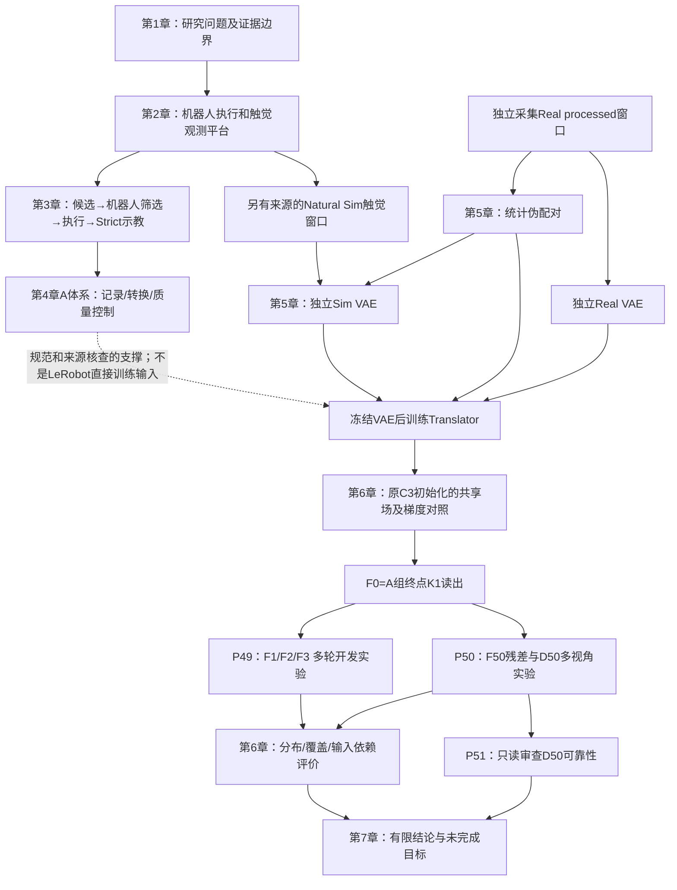

# 全篇研究逻辑总账

日期：2026-11-27。仓库根目录 `/home/zmy/dex_hand_project`。本轮为Stage A，只读静态审计及既有标量/登记复核，不产生L3，不修改论文或实验，不编译、不训练、不推理、不运行仿真，不commit/push。路径均相对仓库根目录；`文件:行`为可定位源码/CSV/JSON行，CSV行号含表头。PDF页码一律为文件物理页号，不能与印刷页码混用（本版本正文区相差8页）。

证据标记：VERIFIED=本轮直接核对所列代码/合同/既有结果；UNKNOWN=材料不足；UNVERIFIED=本轮未作所需深度认证；CONFLICT=来源之间实际冲突。直接读取历史结果文件仅证明其记录内容，不升级为本轮重新执行。L2只限所列范围。

## 权威版本与完整性

- Git提交：`5a7900c55c09a3000067c8b19ab3e090a404c6a0`，分支main；起始已跟踪文件无改动。仓库原有大量未跟踪实验/历史文件，不能以“工作区完全干净”描述。
- 入口：`thesis/thesis.tex:15–21`依次接入七章；第五至七章聚合文件实际input子节；`front/cover`、`front/abstract`以及back声明、致谢均生效。
- 当前PDF：`thesis/releases/draft_2026-11-27/thesis_draft.pdf`，93页，SHA256 `f1d679cd4e6f352fa93ab73bdcb593d644405a1ef8227532eadc2c85787bd28b`。
- 当前源码与发行包：逐一比对`thesis/releases/draft_2026-11-27/SOURCE_MANIFEST.json:5–73`登记的68个文件，全部Hash一致；`thesis_source.zip`是同一交付。故当前采用该PDF及当前主文件，依据是内容/依赖/Hash，而非mtime。
- `thesis/docs/writing_audit/remove_ai_note_2026-11-27/full_thesis_preview.pdf`是交付PDF直接来源；较早hand_naming、reference_frontmatter、abstract_title及87/91页版本是历史预览，不能替代93页版。冻结章节目录是历史快照，设备称谓已按用户授权在当前正文更新，不要求旧快照同步覆盖。
- 当前题名与七章内容相符：平台/示教/数据质量支撑触觉重建方法与评价，题名未暗示已完成实机迁移。
- 现有真实TeXcount文件输出汇总：一至七章分别8531、8966、8587、7627、8658、9285、2360，合计54014（`releases/draft_2026-11-27/WORDCOUNT.md:7–15`及`texcount_files.txt:3–24`）。本轮未重新生成统计产物。旧自动规划标题匹配报告出现第五章MISSING/旧71页，不是当前论文缺章证据。
- 活动依赖静态检查：26个TeX文件；7个chapter、40个section、32个figure、32个table、32个equation环境；147个label无重复，ref无未定义目标；30个不同cite键均存在于reference.bib。表/公式环境数与编号出现数不是数学公式行数。未启用的旧骨架、appendix占位不计入活动正文。

## 一、论文研究对象与主张

论文研究的是：如何在指定欠驱动灵巧手与机械臂模型上，将候选抓取转化为可验证专家轨迹，并组织为语义、时序及来源明确的数据；在缺少认证Real–Sim物理配对时，如何研究完整触觉的统计监督重建以及评价其有效范围。它包含平台与数据工程、约束连接方法及受限迁移探索，不是“一个算法已经完成机器人实机触觉迁移”。依据：第1章1.3/1.4（`ch01_introduction.tex:81–106`），第7章7.1/7.2（对应子节:4–10）。

平台是可重复操作和接触观测的载体；专家轨迹是生成记录的来源；质量控制规定记录能否用于特定研究；跨域触觉研究采用另有明确划分的Real/Natural/Paired子集。技术依赖成立不等于所有示教资产均进入VAE或Translator训练。第四章质量框架可约束后续数据使用，但不能替代第五章自己的窗口来源认证。

## 二、三条主线与四项工作的映射（L01）

|第1章主线（1.4）|对应具体工作|第7章总结|判定|
|---|---|---|---|
|平台与观测集成|工作一：机器人平台、控制与曲面触觉|7.1第1段、7.2第1段|直接对应|
|专家示教与数据|工作二：候选、执行与Strict；工作三：记录、转换及质量控制|7.1第2/3段；7.2第1/2段|一条主线分成两项工作，数量不同不构成事实矛盾|
|有限监督下跨域探索|工作四：统计伪配对、独立表示、映射及对抗/综合评价|7.1第4段、7.2第3段|覆盖第5/6章，不应拆拼为一个成功终态|

`ch01_introduction.tex:98–104`明确将示教与数据合写，`section_7_1…tex:6–10`分开总结。建议Stage B增加一句层级映射，而不是删掉数据质量工作或声称四项原创算法（问题A04）。

## 三、章节输入—方法—输出—证据

|章|问题/输入|方法与实际输出|直接证据与后续依赖|
|---|---|---|---|
|1 绪论|灵巧操作的接触观测、可执行示教和域差异|定义问题、现状、贡献边界与七章职责|`ch01:81–114`；形成研究任务，不是实验成绩|
|2 平台|当前XML/STL、安装关系、控制profile|7臂关节+12手关节/6腱通道、原生touch到16 Patch/712D processed接口|`source/robots/builder.py:126–129`、`source/control/arm.py:392–410`、`source/sensors/tactile/dex_hand.py:294–427`；支撑第3章执行与第4章记录|
|3 候选与示教|物体几何、抓取源、机器人约束|官方GraspQP适配、DexEvolve-style、腕格点、两个目标IK、动态执行和Strict记录|`source/grasping/executor.py:225`、`strict_replay.py:32–44`；Top100清单与Sugar10历史Strict；输出控制序列及验证层级|
|4 数据质量|轨迹/NPZ、Manifest、旧导出、v4包|39D/13D合同、执行前记录、索引/语义修复、分层质量与去重准入|`source/imitation/observation.py:31–41`；`production_recorder.py:146–223`；`production_queue.py:322–349`；不是全库认证|
|5 初始重建|Real/Natural/Paired冻结Train/Validation|GMM统计先验→物理伪配对→独立VAE→GRU Translator→Real-like窗口；原C0逐实例评价|C3 `code/models.py:7–36`、`pipeline_cpu.py:16–76`；C27只2/11联合，通过边界在5.6明确|
|6 优化与评价|原C3双VAE及Translator初始化；另有A组终点F0|共享场Euler、梯度对照、P49/P50探索、距离/覆盖/依赖护栏与D50审计|P44 `code/model.py:6–29`；P49 round/distribution CSV；P50/51原件；输出局部改善及负结果，不是迁移已解决|
|7 总结|上述已实现功能及范围受限结果|四项工作、三类研究结论、四段真实不足与未来验证需求|`section_7_1:4–10`、`7_2:4–8`、`7_3:4–10`；没有添加新实验|

## 四、完整逻辑图

注意：F0不是原C3 Translator，也不是C27；P50从F0重启而非F3续训；P51不优化F50或D50。图中的箭头是证据支持的模块或数据依赖，不是全部经过实机验证的闭环。

## 五、逐项回应审查A–F

- A：三主线/四工作可嵌套解释；现有文字没有显式映射，属于组织歧义，非结果矛盾。
- B：第2章控制/触觉接口到第3章候选执行确有代码链路；桌面惩罚、端点IK、执行监测与Strict不同，不能升级为全轨迹碰撞认证。第3章:132–134已经写清，第7章措辞宜同步收紧。
- C：第4章:279–292单独登记触觉冻结子集，不将LeRobot作为直接训练输入。C3 common.py:24–27从Real索引和Natural windows取数据；pipeline_cpu.py:16从Paired取监督。数据框架衔接成立，全量数据直接继承关系未证明。
- D：第5章独立VAE和Translator→第6章共享场初始化准确；C27只比较，不作P44教师/初始化。后续C13 Decoder和C27 Translator不可组合回填。
- E：7.2保留2/11、49.77%限定、FR100%不足、F50退化及D50限定NO-GO，没有把失败改为成功；P49协议修订详细披露于6.3，摘要式结论未重复细节不构成隐瞒。
- F：平台和记录功能得到限定证据，泛化/真实任务收益没有完成；1.3提出的结构保持和可靠迁移并未实现，5.6/6.3–6.6及7.2明确回应为未验收，7.3给出相应方向。研究目标未达成不等于全文逻辑断裂。

## 六、整章表达与研究基准

可保留：平台接口、分级示教、版本化质量控制、统计伪监督和优化评价的工作链。不能声称：全任务统一Strict成功、LeRobot即触觉迁移训练集、天然共享潜空间、F0全指标合格、FR即物理迁移成功或D50结论适用于D3。

Stage B先完成可从已有材料补齐的图3-6，再补主线映射、数据角色桥接和碰撞限定；不需为维持当前有限结论新增训练、仿真或实机实验。若要扩大为当前模型全链动态认证或真实操作收益，则必须另行立项验证。

## 审计执行完整性记录

起始和结束对`thesis/、outputs/、source/、apps/、configs/、scripts/`下的43516个选定受保护文件，按路径排序和各文件SHA256构造聚合Hash（范围为.tex/.bib/.cls/.sty/.pdf/.csv/.json/.py/.yaml/.yml，排除本机工具、upstream和构建/日志目录）。前后均为：

`b2316374c4848b4920fcebab856aefb2f7591803133214365c22c03c5ed22b3c`

初始Git完整状态字符串SHA256与结束排除本次新审计目录后的状态SHA256均为：

`c8f16815483c7b000a10794d912c95205d66b4ca8c646c387a7e54eec8891c3d`

已跟踪文件结束状态为空，HEAD仍为5a7900c55c09a3000067c8b19ab3e090a404c6a0。此前已有未跟踪文件保留不动。新增只有本目录5个Markdown；未新建JSON、脚本、截图、CSV或编译文件。PDF核心页面在内存渲染核对，没有覆盖原图/PDF。

上述Hash范围不是对所有大体量NPZ/视频/权重的全盘重新认证；本轮没有加载Test/Holdout样本或预测执行，没有写入数据或权重的操作。D50仅作字节Hash核对，未加载推理。原件执行成绩均保留历史身份。本轮没有Git提交/推送，没有进入Stage B。
